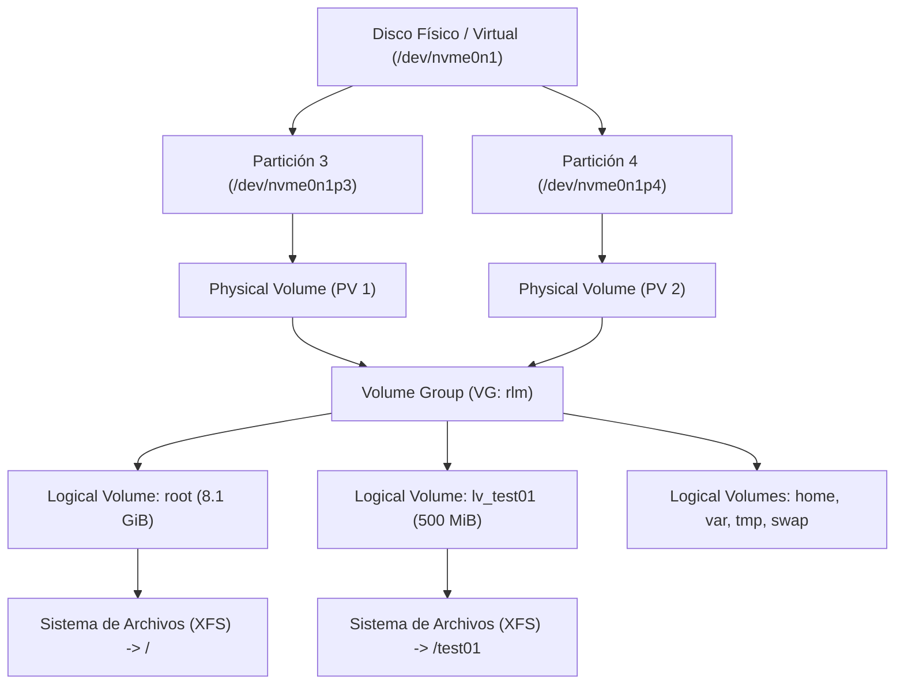

# Clase 1: Instalación de Rocky Linux 10.2, Particionado y Administración de LVM

> **Asignatura:** Temas Selectos de Ingeniería en Computación - DevOps  
> **Tema principal:** Instalación de Rocky Linux Minimal, Arquitectura LVM (Logical Volume Manager), Redimensionamiento de Almacenamiento en vivo y Montajes en `/etc/fstab`.

---

## 1. Resumen de la Clase

En esta primera clase aprendimos a:
1. Configurar una Máquina Virtual en **VMware Workstation Pro** con **Rocky Linux Minimal 10.2**.
2. Diseñar la estructura de particionado manual separando particiones del sistema y del usuario.
3. Entender y aplicar la jerarquía de almacenamiento con **LVM (Logical Volume Manager)**.
4. Crear particiones secundarias, agregarlas a un Grupo de Volúmenes (VG), extender volúmenes lógicos existentes (como `/`) en caliente y crear nuevos volúmenes formateados con **XFS**.
5. Hacer persistentes los montajes automáticos al iniciar el sistema modificando `/etc/fstab` y validando la configuración.

---

## 2. Configuración de la Máquina Virtual (VMware + Anaconda)

### Configuración en VMware Workstation:
- **Sistema Operativo:** Red Hat Enterprise Linux 9 / Rocky Linux 10 (64-bit).
- **Red:** NAT (Network Address Translation).
- **Disco Virtual:** NVMe (20 GiB asignados).

### Esquema de Particionado Inicial durante la Instalación:

| Punto de Montaje | Capacidad | Tipo de Dispositivo | Descripción / Propósito |
| :--- | :--- | :--- | :--- |
| `biosboot` | `1 MiB` | Standard Partition | Requerido para arranque GPT en sistemas BIOS / Legacy. |
| `/boot` | `1024 MiB` | Standard Partition | Archivos del Kernel y gestor de arranque (GRUB). |
| `/` | `4 GiB` | **LVM** *(VG: `rlm`)* | Directorio raíz del sistema operativo. |
| `/home` | `1024 MiB` | **LVM** *(VG: `rlm`)* | Directorios personales de usuarios. |
| `/tmp` | `1024 MiB` | **LVM** *(VG: `rlm`)* | Archivos temporales del sistema. |
| `/var` | `1024 MiB` | **LVM** *(VG: `rlm`)* | Logs, bases de datos y archivos variables. |
| `swap` | `1024 MiB` | **LVM** *(VG: `rlm`)* | Memoria de intercambio (RAM virtual). |

> **Nota:** Al usar un disco de 20 GiB y asignar 8 GiB a la instalación inicial, quedaron **~11 GiB de espacio no asignado** en el disco para realizar los ejercicios prácticos de LVM.

---

## 3. Jerarquía y Conceptos Clave de LVM

LVM es una capa de abstracción entre los discos físicos y los sistemas de archivos. Permite redimensionar almacenamiento en caliente sin necesidad de apagar el servidor.



- **PV (Physical Volume):** Convierte una partición de disco en un recurso reconocible por LVM (`pvcreate`).
- **VG (Volume Group):** Agrupa uno o varios PVs en una gran "piscina" de almacenamiento (`vgcreate` / `vgextend`).
- **LV (Logical Volume):** División lógica creada a partir del VG, equivalente a una partición tradicional (`lvcreate` / `lvextend`).
- **FS (Filesystem):** Formato formateado sobre el LV (ej. XFS, ext4) donde se guardan los archivos (`mkfs.xfs` / `xfs_growfs`).

---

## 4. Guía Práctica de Comandos Ejecutados

### Paso 1: Crear la partición en el espacio libre del disco

```bash
parted -s /dev/nvme0n1 mkpart primary 9670MB 100%
parted -s /dev/nvme0n1 set 4 lvm on
udevadm settle
```
- `parted`: Herramienta para gestionar la tabla de particiones del disco.
- `mkpart primary 9670MB 100%`: Crea la partición 4 utilizando desde los 9.67 GB hasta el 100% del espacio del disco (`/dev/nvme0n1p4`).
- `set 4 lvm on`: Asigna la bandera LVM a la nueva partición.

---

### Paso 2: Crear el Physical Volume (PV)

```bash
pvcreate /dev/nvme0n1p4
pvs
```
- `pvcreate`: Inicializa la nueva partición `/dev/nvme0n1p4` como un volumen físico administrable por LVM.
- `pvs`: Muestra un resumen de todos los PVs creados.

---

### Paso 3: Extender el Volume Group (VG)

```bash
vgextend rlm /dev/nvme0n1p4
vgs
```
- `vgextend rlm /dev/nvme0n1p4`: Añade los 11 GB de la partición 4 al grupo de volúmenes existente llamado `rlm`.
- `vgs`: Muestra el espacio total y el espacio libre disponible en el grupo de volúmenes.

---

### Paso 4: Extender el Logical Volume y el Sistema de Archivos en vivo

```bash
lvextend -L 8.1G /dev/rlm/root
xfs_growfs /dev/rlm/root
```
- `lvextend -L 8.1G /dev/rlm/root`: Aumenta la capacidad del volumen lógico de la raíz `/` de 4.0 GiB a 8.1 GiB.
- `xfs_growfs /dev/rlm/root`: Amplía el sistema de archivos XFS en tiempo real para que reconozca los nuevos 4.1 GiB sin desmontar el sistema.

---

### Paso 5: Crear y formatear un nuevo Volumen Lógico (`lv_test01`)

```bash
lvcreate -L 500M -n lv_test01 rlm
mkfs.xfs /dev/rlm/lv_test01
```
- `lvcreate -L 500M -n lv_test01 rlm`: Crea un nuevo volumen lógico llamado `lv_test01` de 500 MiB dentro del grupo `rlm`.
- `mkfs.xfs /dev/rlm/lv_test01`: Formatea el nuevo volumen lógico con el sistema de archivos XFS.

---

### Paso 6: Crear el directorio y realizar el montaje

```bash
mkdir -p /test01
mount /dev/rlm/lv_test01 /test01/
df -h /test01
```
- `mkdir -p /test01`: Crea el punto de montaje en la raíz del sistema.
- `mount`: Asocia el volumen `/dev/rlm/lv_test01` al directorio `/test01`.
- `df -h /test01`: Muestra el espacio en disco usado y disponible en `/test01`.

---

### Paso 7: Configurar montaje permanente en `/etc/fstab`

Para que el montaje persista tras reiniciar el servidor, se añade la siguiente línea al archivo `/etc/fstab`:

```fstab
/dev/rlm/lv_test01 /test01 xfs defaults 0 0
```

Estructura de `/etc/fstab`:
1. **Dispositivo:** `/dev/rlm/lv_test01` (o UUID).
2. **Punto de montaje:** `/test01`.
3. **Tipo de FS:** `xfs`.
4. **Opciones:** `defaults`.
5. **Dump:** `0` (deshabilitado).
6. **Fsck Pass:** `0` (no verificar al iniciar).

---

### Paso 8: Validar la configuración y recargar systemd

```bash
mount -a
systemctl daemon-reload
```
- `mount -a`: Intenta montar todos los puntos definidos en `/etc/fstab`. Si hay un error de sintaxis en `/etc/fstab`, lo indicará inmediatamente evitando fallos al reiniciar el servidor.
- `systemctl daemon-reload`: Recarga la configuración del administrador del sistema (systemd) para actualizar los puntos de montaje detectados.

---

## 5. Cuadro de Comandos de Inspección y Diagnóstico

| Comando | Función Principal |
| :--- | :--- |
| `lsblk` | Muestra la estructura jerárquica de bloques, particiones, LVM y puntos de montaje. |
| `pvs` / `pvdisplay` | Muestra la lista e información detallada de los Physical Volumes. |
| `vgs` / `vgdisplay` | Muestra la información de los Volume Groups (espacio total y libre). |
| `lvs` / `lvdisplay` | Muestra los Logical Volumes creados y sus tamaños. |
| `df -h` | Muestra los sistemas de archivos montados y su espacio de almacenamiento en formato legible (*human-readable*). |
| `ip a` | Muestra las interfaces de red y las direcciones IP asignadas. |

---

## 6. Notas Técnicas y Resolución de Problemas

1. **BIOS / GPT (`biosboot`):**
   - Cuando se usa tabla de particiones GPT en un sistema con firmware BIOS (Legacy), Anaconda exige crear una partición `biosboot` de `1 MiB`.

2. **Límite Mínimo de XFS (Rocky Linux 10):**
   - En distribuciones basadas en RHEL 10 / Rocky Linux 10, la herramienta `mkfs.xfs` requiere que los volúmenes tengan un tamaño **mínimo de 300 MiB**. Por esta razón, el volumen `lv_test01` se configuró en **500 MiB** en lugar de 100 MiB.

3. **Acceso por SSH:**
   - La opción *Allow SSH root login with password* debe estar habilitada en la instalación.
   - Para conexiones automatizadas se puede agregar la clave pública en `~/.ssh/authorized_keys` con permisos `600`.
