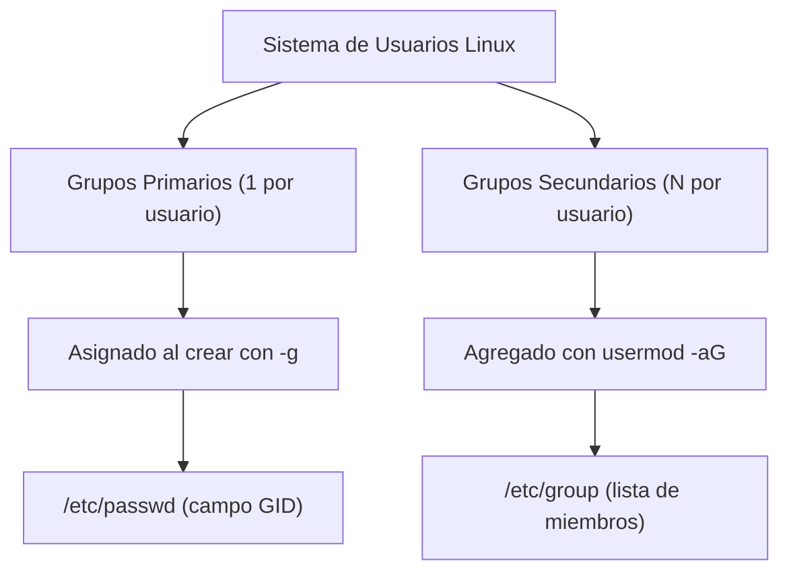
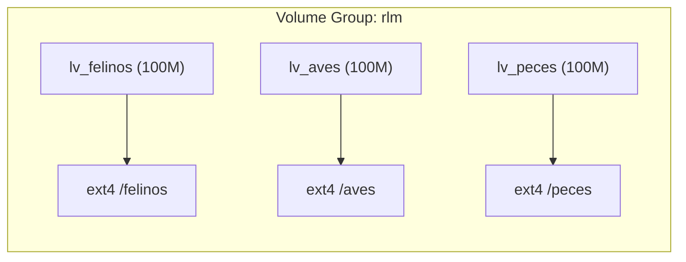
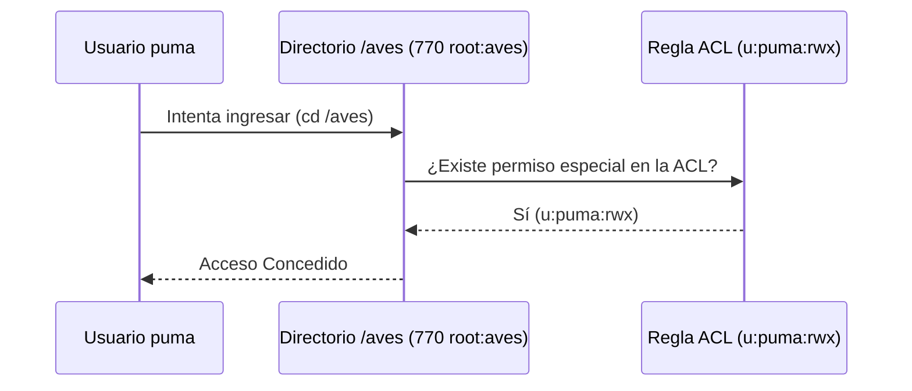
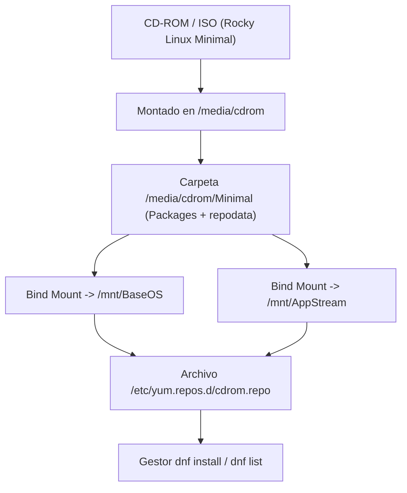

# Clase 2: Administración de Usuarios, Grupos, Permisos, ACLs y Repositorios Locales DNF

> **Asignatura:** Temas Selectos de Ingeniería en Computación - DevOps  
> **Tema principal:** Gestión de Usuarios y Grupos, Archivos de Configuración (`/etc/passwd`, `/etc/shadow`, `/etc/group`), Permisos POSIX, Máscara `umask`, Reglas de Control de Acceso (ACLs) y Configuración de Repositorios DNF/YUM desde Medios Locales.

---

## 1. Resumen de la Clase

En esta segunda sesión práctica aprendimos a:
1. Inspeccionar y entender los archivos del sistema que almacenan usuarios, grupos y contraseñas cifradas en Linux (`/etc/passwd`, `/etc/shadow`, `/etc/group`).
2. Crear y administrar cuentas de usuarios y grupos utilizando IDs personalizados (`UID` y `GID`), así como grupos primarios y secundarios (`useradd`, `groupadd`, `usermod`).
3. Realizar un ejercicio completo integrando **LVM** (Volúmenes Lógicos), montajes persistentes en `/etc/fstab` y creación masiva de cuentas clasificadas por categorías (`felinos`, `aves`, `peces`).
4. Gestionar la seguridad del sistema de archivos mediante permisos octales (`chmod`), cambio de grupo propietario (`chgrp`) y pruebas de cambio de identidad con `su -`.
5. Aplicar **Reglas ACL (Access Control Lists)** mediante `setfacl` y `getfacl` para crear excepciones de permisos de acceso granulares sin alterar los grupos propietarios.
6. Comprender el funcionamiento de la máscara por defecto **`umask`** para la creación de nuevos archivos y directorios.
7. Configurar **Repositorios Locales en DNF/YUM** utilizando imágenes ISO / CD-ROM para instalaciones sin acceso a internet, resolviendo problemas de rutas con **Bind Mounts**.

---

## 2. Archivos Clave del Sistema para Usuarios y Grupos

Linux almacena la información de las cuentas en archivos de texto plano ubicados en el directorio `/etc/`.

| Archivo | Descripción | Permisos por defecto | Comando de Inspección |
| :--- | :--- | :--- | :--- |
| `/etc/passwd` | Cuentas de usuario, UID, GID, home y shell. | Read-all (`644`) | `cat /etc/passwd \| grep puma` |
| `/etc/shadow` | Hashes de contraseñas cifradas y caducidad. | Solo root (`000` / `600`) | `cat /etc/shadow \| grep puma` |
| `/etc/group` | Lista de grupos y miembros secundarios. | Read-all (`644`) | `cat /etc/group \| grep felinos` |

### 2.1 Estructura del archivo `/etc/passwd`
Formato: `usuario:x:UID:GID:Comentario:Home:Shell`
- **Ejemplo:** `puma:x:1000:1001::/home/puma:/bin/bash`
- **Campo `x`:** Indica que la contraseña encriptada está resguardada en `/etc/shadow`.
- **UID `0`:** Reservado exclusivamente para el superusuario `root`.

### 2.2 Estructura del archivo `/etc/shadow`
Formato: `usuario:hash:último_cambio:mín:máx:advertencia:inactividad:expiración:reservado`
- **Ejemplo:** `puma:!:20700:0:99999:7:::`
- **Símbolo `!` o `!!`:** Indica que la cuenta fue creada pero no tiene contraseña asignada (bloqueada para login).

### 2.3 Estructura del archivo `/etc/group`
Formato: `grupo:x:GID:usuarios_secundarios`
- **Ejemplo:** `aves:x:2000:aguila,cardenal`

---

## 3. Guía Práctica de Usuarios y Grupos



### Comandos de Creación y Edición:
```bash
# Crear grupo con GID específico
groupadd -g 2000 aves
groupadd -g 3000 peces
groupadd -g 5000 animales

# Crear usuario asignando grupo primario y UID
useradd -u 2001 -g aves aguila

# Agregar a un grupo secundario (SIN borrar los grupos existentes)
usermod -aG animales aguila

# Verificar identidad del usuario
id aguila
```

> [!WARNING]
> **Cuidado con `usermod -G` sin la bandera `-a`:**  
> Usar `usermod -G grupo` sobreescribirá todos los grupos secundarios previos del usuario. Para **añadir** un grupo conservando los existentes, se debe usar siempre `usermod -aG grupo usuario`.

---

## 4. Ejercicio Práctico Integrador (Almacenamiento LVM + Usuarios)

### Requerimientos:
1. Crear 3 Volúmenes Lógicos de **100 MiB** montados en `/felinos`, `/aves` y `/peces`.
2. Crear los grupos `felinos` (GID 1001), `aves` (GID 2000) y `peces` (GID 3000).
3. Crear 9 usuarios con UIDs en los rangos asignados a cada categoría.



### Comandos Solución del Ejercicio:

```bash
# 1. Crear Grupos
groupadd -g 1001 felinos
groupadd -g 2000 aves
groupadd -g 3000 peces
groupadd -g 5000 animales

# 2. Crear Usuarios (Felinos: 1000-1999, Aves: 2001-2999, Peces: 3000-3999)
useradd -u 1000 -g felinos puma
useradd -u 1002 -g felinos tigre
useradd -u 1003 -g felinos leon

useradd -u 2001 -g aves aguila
useradd -u 2002 -g aves cardenal
useradd -u 2003 -g aves colibri

useradd -u 3000 -g peces tiburon
useradd -u 3001 -g peces marlin
useradd -u 3002 -g peces manta

usermod -aG animales aguila

# 3. Crear LVMs de 100M
lvcreate -L 100M -n lv_felinos rlm
lvcreate -L 100M -n lv_aves rlm
lvcreate -L 100M -n lv_peces rlm

# 4. Formatear y Crear Puntos de Montaje
mkfs.ext4 /dev/rlm/lv_felinos
mkfs.ext4 /dev/rlm/lv_aves
mkfs.ext4 /dev/rlm/lv_peces
mkdir -p /felinos /aves /peces

# 5. Montar y hacer persistente en /etc/fstab
mount /dev/rlm/lv_felinos /felinos
mount /dev/rlm/lv_aves /aves
mount /dev/rlm/lv_peces /peces

echo '/dev/rlm/lv_felinos /felinos ext4 defaults 0 0' >> /etc/fstab
echo '/dev/rlm/lv_aves /aves ext4 defaults 0 0' >> /etc/fstab
echo '/dev/rlm/lv_peces /peces ext4 defaults 0 0' >> /etc/fstab

mount -a
systemctl daemon-reload
```

---

## 5. Permisos POSIX y Reglas ACL (Access Control Lists)

### 5.1 Permisos POSIX tradicionales (`chmod`, `chgrp`)
Los permisos se dividen en tres bloques: **Usuario (Owner)**, **Grupo (Group)** y **Otros (Others)**.

| Permiso | Valor Octal | En Archivos | En Directorios |
| :---: | :---: | :--- | :--- |
| `r` (read) | `4` | Leer contenido del archivo | Listar contenido (`ls`) |
| `w` (write) | `2` | Modificar contenido del archivo | Crear/Eliminar archivos dentro |
| `x` (execute) | `1` | Ejecutar como programa/script | Entrar al directorio (`cd`) |

#### Configuración de accesos por grupo a los directorios del ejercicio:
```bash
# Cambiar grupo propietario y restringir acceso a otros
chgrp felinos /felinos && chmod 770 /felinos
chgrp aves /aves && chmod 770 /aves
chgrp peces /peces && chmod 770 /peces
```

---

### 5.2 Reglas ACL (`getfacl` y `setfacl`)

Cuando la estructura tradicional de permisos no es suficiente (ejemplo: otorgar acceso a un usuario específico sin hacerlo parte del grupo propietario), se utilizan las **ACLs**.

> **Caso de Estudio:** Permitir que el usuario `puma` (del grupo `felinos`) pueda leer y escribir en la carpeta `/aves` (propietario `root:aves` con permisos `770`).



#### Comandos ACL aplicados:
```bash
# 1. Consultar ACLs actuales
getfacl /aves

# 2. Agregar excepción de acceso para el usuario puma
setfacl -m u:puma:rwx /aves

# 3. Verificar el cambio (aparece un '+' en los permisos del ls -ld)
getfacl /aves
ls -ld /aves/
# drwxrwxr--+ 3 root aves 1024 sep 4 07:51 /aves/

# 4. Prueba de escritura con puma
su - puma
cd /aves
touch text.txt
```

---

## 6. La Máscara de Permisos por Defecto (`umask`)

La regla `umask` determina los permisos iniciales con los que se crean nuevos archivos y directorios.

- **Valor máximo teórico:**
  - Directorios: `777` (`rwxrwxrwx`)
  - Archivos: `666` (`rw-rw-rw-`)
- **Máscara por defecto (`0022`):**
  - Permisos de nuevo directorio: `777 - 022 = 755` (`drwxr-xr-x`)
  - Permisos de nuevo archivo: `666 - 022 = 644` (`-rw-r--r--`)

#### Modificar la máscara temporalmente:
```bash
# Restringir permisos para que solo el propietario tenga acceso
umask 0077

# Nuevos directorios se crearán con 700 (drwx------)
# Nuevos archivos se crearán con 600 (-rw-------)
```

---

## 7. Configuración de Repositorios DNF/YUM desde Medios Locales (ISO / CD-ROM)

Cuando se trabaja con servidores en entornos aislados o sin conexión a internet, se utiliza la imagen ISO como repositorio de instalación local.



### 7.1 Creación del archivo de repositorio (`/etc/yum.repos.d/cdrom.repo`)
```ini
[BaseOs]
name=BaseOS
baseurl=file:///mnt/BaseOS
enabled=1
gpgcheck=0

[AppStream]
name=AppStream
baseurl=file:///mnt/AppStream
enabled=1
gpgcheck=0
```

### 7.2 Resolución de Compatibilidad para ISO Minimal mediante Bind Mounts

> [!NOTE]
> En la **ISO Completa (DVD)** las carpetas `BaseOS` y `AppStream` existen en la raíz de la ISO. En la **ISO Minimal**, todo está unificado dentro de la subcarpeta `/Minimal`. Para hacer funcionar el archivo `.repo` anterior sin modificarlo, se utilizan **Bind Mounts**.

```bash
# 1. Desmontar /mnt si estaba en uso
cd /
umount -l /mnt

# 2. Crear directorios de soporte en el disco local
mkdir -p /media/cdrom /mnt/BaseOS /mnt/AppStream

# 3. Montar la ISO física/virtual
mount /dev/cdrom /media/cdrom

# 4. Vincular la carpeta Minimal a las rutas esperadas por el archivo .repo
mount --bind /media/cdrom/Minimal /mnt/BaseOS
mount --bind /media/cdrom/Minimal /mnt/AppStream

# 5. Limpiar y validar el repositorio
dnf clean all
dnf repolist
```

### 7.3 Diferencia entre ISO Minimal e ISO DVD
- **ISO Minimal (~2 GB):** Contiene únicamente paquetes esenciales del sistema (`tree`, `net-tools`, `tar`, `bash-completion`, etc.).
- **ISO DVD (~10 GB):** Contiene el catálogo completo de paquetes empresariales como el servidor web Apache (`httpd`), bases de datos y entornos gráficos.

---

## 8. Guía de Referencia y Atajos Útiles de Terminal

| Acción / Necesidad | Comando / Combinación |
| :--- | :--- |
| **Conexión SSH desde Windows** | `ssh root@192.168.71.128` |
| **Recargar historial de Bash** | `history -r` |
| **Salir de `vi` sin guardar** | `Esc` + `:q!` + `Enter` |
| **Salir de `vi` guardando cambios** | `Esc` + `:wq` + `Enter` |
| **Borrar archivo** | `rm nombre_archivo` |
| **Borrar directorio y contenido** | `rm -rf nombre_directorio` |
| **Imprimir mensaje a consola física** | `echo "texto" > /dev/tty1` |
