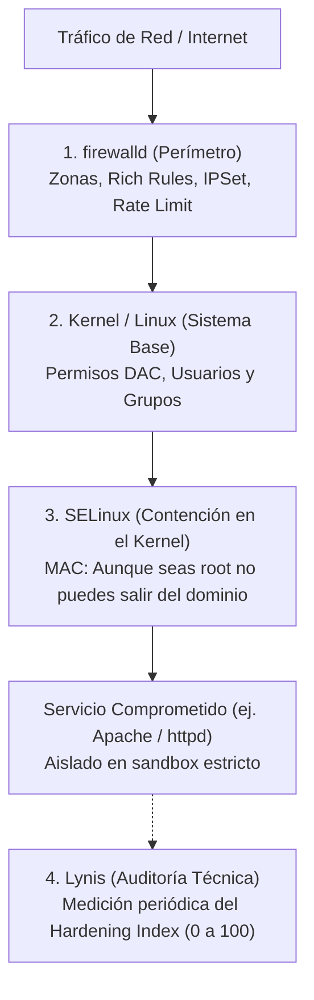
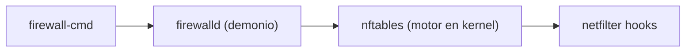
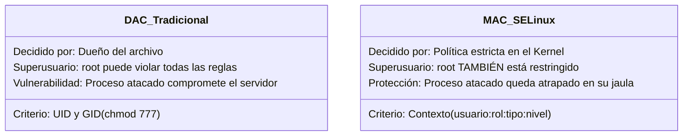

# Clase 3: Gestión Avanzada de Paquetes, Contención con firewalld, SELinux y Auditoría con Lynis

> **Asignatura:** Temas Selectos de Ingeniería en Computación - DevOps  
> **Tema principal:** Paquetería (`dnf` vs `rpm`, compatibilidad `el10` vs `el9`), Servidor Web Apache (`httpd`), Cortafuegos (`firewalld` avanzado), Control de Acceso Obligatorio (`SELinux`) y Auditoría de Hardening (`Lynis`).

---

## 1. Resumen Ejecutivo de la Sesión

En esta tercera sesión se abordó el concepto de **defensa en profundidad y contención en Linux**, transitando de los controles **detectivos** (vistos en sesiones anteriores) a los controles **preventivos** que impiden activamente intrusiones y contención de daños:



1. **Gestión de Paquetes y Distribución:** Restauración de repositorios oficiales tras entornos offline, diferencias operativas entre `rpm` (bajo nivel) y `dnf` (alto nivel), y resolución de conflictos de versión (`el10` vs `el9`).
2. **Perímetro de Red con `firewalld`:** Arquitectura basada en `nftables`, aislamiento por zonas (`public`, `admin`, `storage`, `trusted`, `drop`), mitigación de fuerza bruta con *rate limiting* y *rich rules*, listas negras con `ipset` y registro de paquetes rechazados (`--set-log-denied`).
3. **Contención Interna con `SELinux`:** Desmitificación del mito "desactiva SELinux", modelo MAC (*Mandatory Access Control*), inspección de contextos de seguridad (`ls -Z`), habilitación de puertos no estándar para servicios web (`semanage port`), etiquetado persistente de almacenamiento web (`semanage fcontext` y `restorecon`), y contención real de un proceso atacante (`runcon`).
4. **Evaluación de Seguridad con `Lynis`:** Ejecución de auditorías automáticas de hardening del sistema, análisis de directivas críticas (`warning` vs `suggestion`) y cálculo del *Hardening Index*.

---

## 2. Fundamentos Teóricos: De Detectar a Impedir

Los controles de seguridad en sistemas operativos empresariales se clasifican según el momento en que actúan:

| Tipo de Control | Función Primaria | Herramientas y Mecanismos en Linux |
| :--- | :--- | :--- |
| **🛡️ Preventivos** | Impiden que el incidente ocurra en primer lugar. | `firewalld`, `SELinux`, llaves SSH, `umask`, políticas de contraseñas. |
| **🔍 Detectivos** | Alertan y registran cuando una acción no autorizada ocurre. | `auditd`, `lastcomm`, `tlog`, registros de `firewalld` (`log-denied`), AIDE. |
| **🔧 Correctivos** | Restauran el estado del sistema tras un incidente o falla. | Respaldos, snapshots LVM, redundancia RAID, imágenes de despliegue. |

> [!NOTE]
> **Defensa en Profundidad:** Si un atacante burla el firewall de red y explota una vulnerabilidad en el servidor web (como ejecución remota de código en Apache), **SELinux** actúa como jaula de contención: el atacante hereda el contexto `httpd_t` y el kernel le prohíbe terminantemente leer archivos críticos (`/etc/shadow`), invocar shells de administración o crear conexiones a otros servidores internos, incluso si el proceso corre como `root`.

---

## 3. Módulo 1: Paquetería Empresarial (`dnf` vs `rpm`) y Repositorios

### 3.1 Restauración de Repositorios Oficiales
En la práctica previa se desactivaron los repositorios remotos para trabajar offline con la imagen ISO montada en `/media/cdrom`. Para volver a habilitar la descarga vía internet:

```bash
# 1. Localizar los archivos .repo en el sistema
find / -name '*.repo'

# 2. Reubicar los repositorios oficiales a su directorio de trabajo
cd /root/
mv *.repo /etc/yum.repos.d/

# 3. Retirar el repositorio local del CD-ROM para evitar búsquedas offline
cd /etc/yum.repos.d/
mv cdrom.repo /root/

# 4. Limpiar metadatos locales y verificar repositorios remotos sincronizados
dnf clean all
dnf repolist
```

### 3.2 Búsqueda de Proveedores con `dnf whatprovides`
Cuando se necesita un comando del sistema pero no se conoce el paquete exacto que lo incluye (por ejemplo, el cliente de red `nc`):

```bash
dnf whatprovides nc
```

* **Salida:** `nmap-ncat-4:7.92-5.el10.x86_64`
* **Interpretación:** 
  - `nmap-ncat`: Es el nombre del paquete oficial.
  - `@System`: Informa que ya está instalado en el sistema.
  - `.el10`: Compilado específicamente para **Enterprise Linux 10**.

### 3.3 Compatibilidad de Versiones (`cat /etc/os-release`)
Al consultar `/etc/os-release`, se identifica la plataforma:
- `VERSION_ID="10.2"`
- `PLATFORM_ID="platform:el10"`

```bash
# Intento de instalar paquete de versión anterior (RHEL 9 / Rocky 9 en Rocky 10)
rpm -ivh nmap-ncat-7.92-5.el9.x86_64.rpm
```
> [!WARNING]
> Instalar paquetes con sufijo `.el9` en un sistema `el10` rompe la estabilidad debido a diferencias binarias en librerías compartidas fundamentales como `glibc` y OpenSSL.

### 3.4 Comparativa: `rpm` frente a `dnf`

| Criterio | `rpm` (Bajo Nivel) | `dnf` (Alto Nivel) |
| :--- | :--- | :--- |
| **Dependencias** | No resuelve; falla si falta una librería. | Descarga y resuelve dependencias automáticamente. |
| **Origen** | Solo archivos `.rpm` locales previamente descargados. | Repositorios locales, remotos en la nube o URLs. |
| **Idempotencia** | Falla con error si el paquete ya existe. | Si el paquete ya existe, no hace nada o lo actualiza. |
| **Comando de instalación** | `rpm -ivh paquete.rpm` (`-i` install, `-v` verbose, `-h` hash) | `dnf install paquete.rpm` |

---

## 4. Módulo 2: Filtrado y Aislamiento Perimetral con `firewalld`

`firewalld` es un demonio dinámico que administra las reglas del subsistema **`nftables`** del kernel de Linux.



### 4.1 Modelo de Evaluación de Zonas
Una zona es un nivel de confianza asignado a una interfaz o a una IP de origen:

```text
[ Paquete Entrante ]
         │
         ▼
¿Coincide la IP origen con alguna zona (--add-source)?
   ├── SÍ ──► Procesa en esa zona (ej. admin o trusted)
   │
   └── NO ──► Procesa en la zona de la interfaz de red (por defecto: public)
```

| Zona | Comportamiento por Defecto | Recomendación de Uso |
| :--- | :---: | :--- |
| `drop` | Descarta paquetes en silencio (sin respuesta ICMP). | IPs hostiles, escaneos y ataques detectados. |
| `block` | Rechaza la conexión enviando un paquete de rechazo. | Bloqueo explícito de servicios no permitidos. |
| `public` | Permite únicamente los puertos/servicios abiertos explícitamente. | **Zona predeterminada** para interfaces expuestas. |
| `trusted` | **Acepta todo el tráfico incondicionalmente.** | Usar con extrema precaución para subredes seguras. |

> [!CAUTION]
> **Runtime vs Permanent:**  
> Cualquier regla sin `--permanent` vive únicamente en memoria RAM y se destruye al reiniciar.  
> Cualquier regla con `--permanent` se guarda en disco pero **no entra en vigor** hasta ejecutar `firewall-cmd --reload`.

### 4.2 Configuración de Zona Dedicada de Administración
Para evitar que servicios críticos de gestión (SSH, Cockpit) estén expuestos a cualquier cliente de la red pública:

```bash
# 1. Crear una zona personalizada de administración
firewall-cmd --permanent --new-zone=admin

# 2. Asignar exclusivamente la subred segura de administración
firewall-cmd --permanent --zone=admin --add-source=192.168.100.0/24

# 3. Habilitar SSH y Cockpit en la zona admin
firewall-cmd --permanent --zone=admin --add-service=ssh
firewall-cmd --permanent --zone=admin --add-service=cockpit

# 4. Remover SSH de la zona pública general
firewall-cmd --permanent --zone=public --remove-service=ssh

# 5. Aplicar y verificar
firewall-cmd --reload
firewall-cmd --zone=admin --list-all
firewall-cmd --zone=public --list-all
```

### 4.3 Mitigación de Fuerza Bruta con Rich Rules y Rate Limit
Las reglas avanzadas (*rich rules*) permiten definir condiciones complejas de tráfico, registro y límite de conexiones por unidad de tiempo:

```bash
# Limitar a máximo 3 intentos de conexión SSH por minuto por IP origen
firewall-cmd --permanent --zone=admin --add-rich-rule='rule service name="ssh" accept limit value="3/m"'

# Registrar los intentos en el syslog con prefijo personalizado antes de aceptar
firewall-cmd --permanent --zone=admin --add-rich-rule='rule service name="ssh" log prefix="SSH-INTENTO " level="notice" limit value="5/m" accept'

firewall-cmd --reload
```

### 4.4 Listas Negras Eficientes con `ipset`
En lugar de crear cientos de reglas individuales (que degradan el rendimiento del CPU), se utiliza un **ipset** indexado en memoria mediante tablas hash:

```bash
# 1. Crear el conjunto de IPs de tipo hash
firewall-cmd --permanent --new-ipset=blacklist --type=hash:ip

# 2. Agregar una IP bloqueada
firewall-cmd --permanent --ipset=blacklist --add-entry=192.168.100.99

# 3. Enviar todo el ipset a la zona 'drop'
firewall-cmd --permanent --zone=drop --add-source=ipset:blacklist

firewall-cmd --reload
```

### 4.5 Auditoría de Denegaciones y Botón de Pánico
```bash
# Activar el registro de todo paquete rechazado o descartado
firewall-cmd --set-log-denied=all
firewall-cmd --get-log-denied

# Ver los paquetes rechazados en vivo
journalctl -kf | grep -i 'REJECT\|DROP'

# Botón de Pánico (aislamiento inmediato de red ante incidentes - ISO 27035)
firewall-cmd --panic-on     # Corta 100% del tráfico de red instantáneamente
firewall-cmd --query-panic  # Consulta si el modo pánico está activo (yes/no)
firewall-cmd --panic-off    # Restaura el tráfico normal
```

---

## 5. Módulo 3: Control de Acceso Obligatorio con SELinux

### 5.1 Diferencia Fundamental entre DAC y MAC



### 5.2 Estructura del Contexto de Seguridad (`ls -Z`)
Cada objeto (archivo, directorio, proceso, puerto de red) posee una etiqueta:

$$\text{Contexto} = \mathbf{usuario} : \mathbf{rol} : \mathbf{tipo} : \mathbf{nivel}$$

* **Ejemplo:** `system_u:object_r:httpd_sys_content_t:s0`
  - `system_u`: Usuario de SELinux (identidad del sistema).
  - `object_r`: Rol del objeto (archivos usan `object_r`).
  - **`httpd_sys_content_t` (Tipo/Dominio):** **El campo más importante.** Determina a qué tipos de datos puede acceder cada proceso. Apache solo tiene autorización para leer objetos con tipos autorizados (`httpd_sys_content_t`, `httpd_config_t`, etc.).
  - `s0`: Categoría de sensibilidad multinivel.

### 5.3 Modos de Operación de SELinux
```bash
getenforce       # Consulta el modo actual (Enforcing, Permissive, Disabled)
setenforce 1     # Cambia a modo Enforcing (aplica y bloquea)
setenforce 0     # Cambia a modo Permissive (no bloquea, solo registra en audit.log)
```

> [!WARNING]
> **Regla de Oro:** `setenforce 0` **no es una solución**. Desactivar SELinux equivale a quitar las cerraduras de una puerta porque perdiste la llave. Los problemas de SELinux en el 99% de los casos se resuelven con:
> 1. Un boolean de configuración (`setsebool`).
> 2. Una regla de puerto (`semanage port`).
> 3. Una corrección de etiqueta de archivo (`semanage fcontext` + `restorecon`).

### 5.4 Laboratorio Real: Apache en Puerto 81 y Bloqueo de SELinux

#### El Problema:
Al cambiar el puerto estándar 80 por el puerto 81 en Apache:
```bash
vi /etc/httpd/conf/httpd.conf
# Se cambia la línea: Listen 80  -->  Listen 81
systemctl restart httpd
```
El comando **falla** y `systemctl status httpd` muestra error `Permission denied: AH00072: make_sock: could not bind to address [::]:81`.

#### La Causa:
SELinux tiene una política de tipos de puertos (`http_port_t`) que limita a qué puertos puede enlazar el proceso `httpd_t`. El puerto 81 no está en la lista permitida.

#### La Solución Definitiva:
```bash
# 1. Instalar herramientas de administración de SELinux
dnf install -y policycoreutils-python-utils setroubleshoot-server

# 2. Consultar qué puertos están autorizados para Apache actualmente
semanage port -l | grep http_port_t

# 3. Añadir de forma permanente el puerto 81 TCP a la política http_port_t
semanage port -a -t http_port_t -p tcp 81

# 4. Reiniciar Apache y verificar
systemctl restart httpd
systemctl status httpd
curl localhost:81
```

### 5.5 Etiquetado Persistente de Almacenamiento Web
Si los archivos de un sitio web se ubican fuera de `/var/www/html` (por ejemplo en `/web/sitio`):

```bash
# FORMA CORRECTA Y PERSISTENTE:
# 1. Definir la regla en la política de SELinux
semanage fcontext -a -t httpd_sys_content_t "/web(/.*)?"

# 2. Aplicar la regla al sistema de archivos existente
restorecon -Rv /web

# Verificar contexto aplicado
ls -Zd /web /var/www/html
```

> [!IMPORTANT]
> **`chcon` vs `semanage fcontext`:**  
> `chcon` es una modificación temporal que desaparece con el primer mantenimiento de disco o `restorecon`.  
> `semanage fcontext` registra la regla de manera permanente en la base de datos de SELinux.

### 5.6 Demostración de Contención contra Ataques (`runcon`)
¿Qué pasa si un atacante toma el control de Apache e intenta robar las contraseñas del servidor?

```bash
# Ejecutar un comando simulando estar dentro del proceso confinado de Apache:
runcon -t httpd_t cat /etc/shadow
```
* **Resultado:** `cat: /etc/shadow: Permiso denegado` (Incluso ejecutándose como superusuario `root`).
* **Verificación en el registro de auditoría:**
  ```bash
  ausearch -m AVC -ts recent | audit2why
  ```

---

## 6. Módulo 4: Auditoría Automatizada de Seguridad con Lynis

**Lynis** es una herramienta de auditoría de seguridad para sistemas Unix/Linux que evalúa cientos de puntos de control y emite un índice de robustez (*Hardening Index*) de 0 a 100.

### 6.1 Instalación y Ejecución de la Auditoría
```bash
# Instalar repositorio EPEL y la herramienta Lynis
dnf install -y epel-release
dnf install -y lynis

# Ejecutar auditoría completa del sistema
lynis audit system

# Consultar el puntaje de endurecimiento obtenido (Hardening Index)
grep hardening_index /var/log/lynis-report.dat
```

### 6.2 Priorización y Remediación con Criterio de Riesgo
El reporte genera dos tipos de alertas en `/var/log/lynis-report.dat`:
1. **`warning[]` (Advertencias):** Vulnerabilidades y configuraciones críticas que deben atenderse de inmediato.
2. **`suggestion[]` (Sugerencias):** Recomendaciones de mejora progresiva.

```bash
# Consultar advertencias críticas prioritarias
grep '^warning\[\]=' /var/log/lynis-report.dat

# Ver el detalle técnico de una comprobación específica
lynis show details SSH-7408
```

### 6.3 Ciclo de Remediación y Validación
```bash
# Guardar reporte de la línea base antes de aplicar cambios
cp /var/log/lynis-report.dat /root/lynis-inicial.dat

# ... Se aplican configuraciones de hardening ...

# Volver a auditar y comparar calificaciones
lynis audit system
grep hardening_index /root/lynis-inicial.dat /var/log/lynis-report.dat

# Validar que los servicios esenciales sigan en operación (¡no romper producción!)
systemctl is-active httpd sshd firewalld auditd
getenforce
```

---

## 7. Secuencia Histórica de Comandos Ejecutados en la Clase

La siguiente lista documenta el orden cronológico exacto de comandos ejecutados en el laboratorio de la sesión:

```bash
# === 1. Localización y Restauración de Repositorios ===
find / -name '*.repo'
cd /root/
ls
mv *.repo /etc/yum.repos.d/
cd /etc/yum.repos.d/
ls
mv cdrom.repo /root/
dnf clean all
dnf repolist

# === 2. Búsqueda e Inspección de Paquetes ===
dnf whatprovides nc
cd /root/
ls
rpm -ivh nmap-ncat-7.92-5.el10.x86_64.rpm
dnf install nmap-ncat-7.92-5.el10.x86_64.rpm
cat /etc/os-release
rpm -ivh nmap-ncat-7.92-5.el9.x86_64.rpm    # Prueba de incompatibilidad de plataforma

# === 3. Preparación de Herramientas de SELinux y Apache ===
dnf install -y policycoreutils-python-utils setroubleshoot-server
ls -Z /var/www/html
dnf install -y httpd
ls -Z /var/www/html
ls -Z /
ls -lZ /etc/httpd/
ls -lZ /var/www/

# === 4. Despliegue de Apache y Verificación Inicial ===
systemctl enable --now httpd
getsebool -a | grep httpd
setenforce 1
getenforce
curl localhost

# === 5. Ejercicio de Cambio de Puerto y Solución en SELinux ===
# Editar httpd.conf cambiando 'Listen 80' por 'Listen 81'
vi /etc/httpd/conf/httpd.conf
systemctl restart httpd     # Falla por restricción de SELinux
systemctl status httpd      # Visualizar error de bind en puerto 81
getsebool -a | grep httpd

# Autorizar el puerto 81 en SELinux para el tipo http_port_t
semanage port -a -t http_port_t -p tcp 81

# Reiniciar Apache exitosamente y probar
systemctl restart httpd
curl localhost:81
```

---

## 8. Guía Rápida de Comandos (Cheat Sheet de Estudio)

| Comando | Categoría | Función / Propósito Práctico |
| :--- | :--- | :--- |
| `dnf whatprovides <comando>` | Paquetería | Averigua qué paquete RPM proporciona un archivo o comando ejecutable. |
| `rpm -ivh <archivo.rpm>` | Paquetería | Instala un RPM local con salida detallada (`-v`) y barra visual (`-h`). |
| `firewall-cmd --permanent --zone=<zona> --add-service=<svc>` | Cortafuegos | Abre un servicio en la zona especificada de forma persistente. |
| `firewall-cmd --reload` | Cortafuegos | Recarga la configuración del firewall en memoria sin cortar conexiones activas. |
| `firewall-cmd --set-log-denied=all` | Cortafuegos | Habilita el registro de auditoría en syslog para paquetes rechazados. |
| `getenforce` / `setenforce 1` | SELinux | Consulta o activa el modo estricto de contención (`Enforcing`). |
| `ls -ldZ <ruta>` | SELinux | Muestra el contexto de seguridad (`usuario:rol:tipo:nivel`) de un recurso. |
| `semanage port -l \| grep <tipo>` | SELinux | Lista los puertos TCP/UDP autorizados para un dominio de servicio. |
| `semanage port -a -t http_port_t -p tcp <puerto>` | SELinux | Añade un puerto TCP personalizado a la política de Apache. |
| `semanage fcontext -a -t <tipo> "<regex>"` | SELinux | Registra una regla de etiquetado permanente para una ruta de disco. |
| `restorecon -Rv <ruta>` | SELinux | Aplica y sincroniza las etiquetas reales del disco según la base de datos de políticas. |
| `runcon -t <dominio> <comando>` | SELinux | Ejecuta un binario simulando pertenecer a un dominio específico (prueba de contención). |
| `lynis audit system` | Auditoría | Ejecuta una auditoría completa del sistema y calcula el índice de hardening. |
