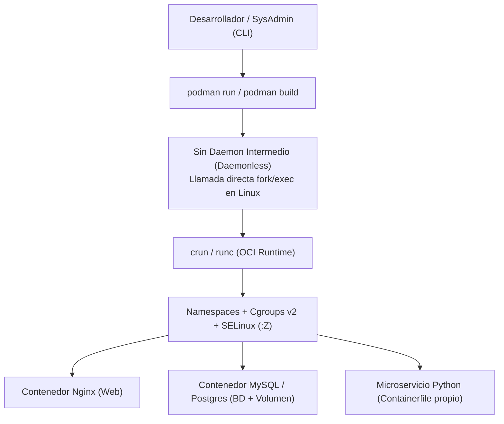
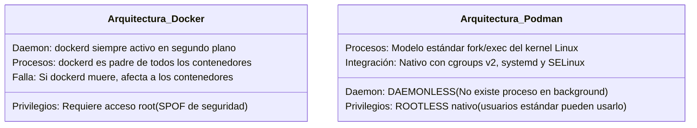
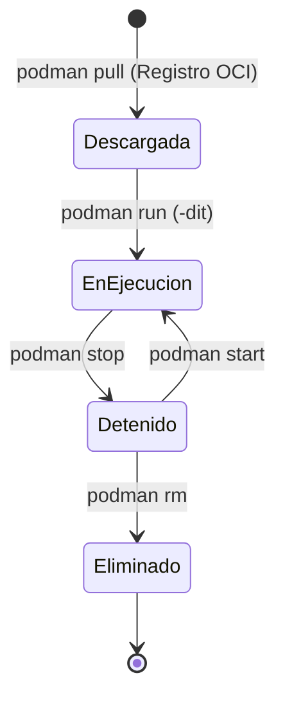
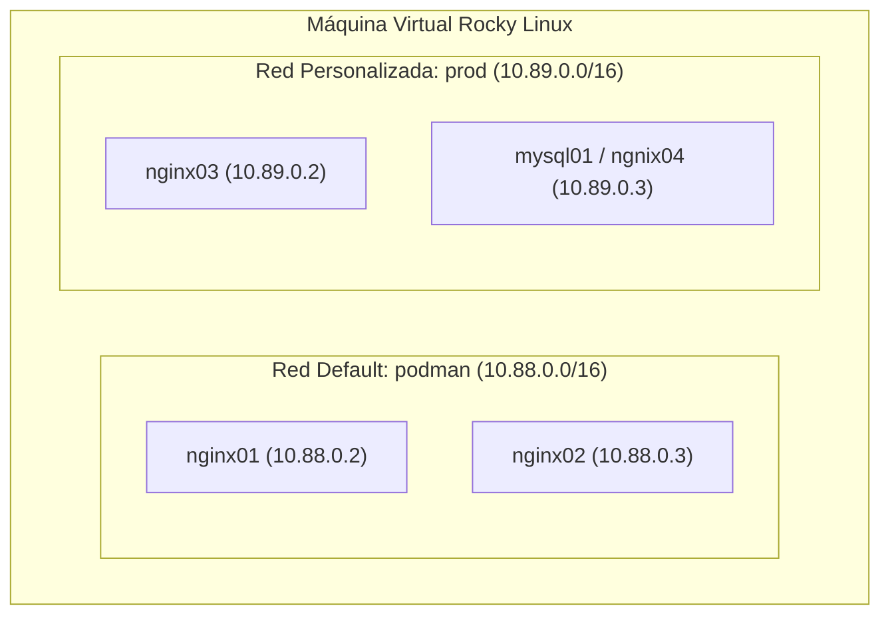
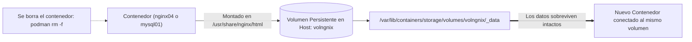
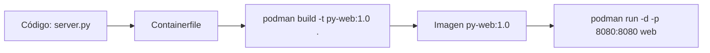

# Clase 4: Contenedores con Podman, Redes Virtuales, Volúmenes y Containerfiles

> **Asignatura:** Temas Selectos de Ingeniería en Computación - DevOps  
> **Tema principal:** Motor de Contenedores Podman (Daemonless y Rootless), Arquitectura OCI, Redes personalizadas (`bridge`), Volúmenes Persistentes (`storage`), Construcción de Imágenes con `Containerfile` y Buenas Prácticas en RHEL / Rocky Linux.

---

## 1. Resumen Ejecutivo de la Sesión

En esta cuarta sesión se realizó una inmersión completa en la **tecnología de contenedores de nivel empresarial** bajo el ecosistema Red Hat Enterprise Linux / Rocky Linux 10, sustituyendo los motores tradicionales basados en demonios (Docker) por la arquitectura moderna, modular y segura de **Podman**:



### Objetivos y Prácticas Clave Desarrolladas:
1. **Identidad y Privilegios en el Host:** Vaciado de caché de identidad con `sss_cache -E` y auditoría de permisos administrativos con `sudo -l -U`.
2. **Fundamentos de Podman vs Docker:** Eliminación del demonio centralizado (`dockerd`), seguridad en modo **Rootless** (sin privilegios de `root`), e integración nativa con `systemd` y `auditd`.
3. **Ciclo de Vida de Contenedores:** Gestión de estados (`pull`, `run`, `stop`, `start`, `exec`, `rm`, `rmi`) con Nginx.
4. **Segmentación de Redes Virtuales:** Creación de redes personalizadas (`prod` en `10.89.0.0/16`) con aislamiento de tráfico y resolución interna.
5. **Persistencia de Datos con Volúmenes:** Uso de `podman volume` para garantizar que bases de datos transaccionales (MySQL / PostgreSQL) no pierdan información al destruir o recrear contenedores.
6. **Construcción de Imágenes con `Containerfile`:**
   - Creación de un microservicio web en **Python 3** (sin dependencias externas, usuario sin privilegios `1001` y endpoints `/health`).
   - Automatización de bases de datos con scripts SQL de inicialización (`init.sql`).
   - Creación masiva de usuarios en contenedores Ubuntu mediante archivos de texto (`usuarios.txt`).

---

## 2. Arquitectura: ¿Por qué Podman en lugar de Docker?

Históricamente Docker popularizó los contenedores, pero su diseño presenta limitaciones críticas en servidores empresariales:



| Criterio | Docker | Podman |
| :--- | :--- | :--- |
| **Demonio Central** | Requiere el servicio `dockerd` corriendo como `root`. | **Daemonless:** Ejecución directa mediante `crun`/`runc`. |
| **Seguridad de Ejecución** | El socket `/var/run/docker.sock` otorga root equivalente. | **Rootless por defecto:** Cada usuario administra sus propios contenedores. |
| **Integración con Systemd** | Difícil de gestionar por unidad de systemd individual. | Genera archivos unitarios nativos con `podman generate systemd`. |
| **Compatibilidad** | Estándar de facto histórico. | **100% compatible con OCI y sintaxis Docker** (`alias docker=podman`). |
| **Agrupación tipo Kubernetes** | Requiere Docker Compose o Swarm. | Soporte nativo de **Pods** (`podman pod create`). |

---

## 3. Módulo 1: Instalación y Ciclo de Vida del Contenedor

### 3.1 Instalación en Rocky Linux
```bash
dnf install -y podman
podman version
podman info
```

### 3.2 El Ciclo de Vida


### 3.3 Descarga de Imágenes (`podman pull`)
Por seguridad y consistencia en Red Hat / Rocky Linux, se recomienda utilizar el nombre calificado completo (**FQIN** - *Fully Qualified Image Name*):

```bash
# Descarga explícita desde Docker Hub
podman pull docker.io/library/nginx:latest

# Listar imágenes en el almacén local
podman images
```
* **Salida de `podman images`:**
  - `REPOSITORY`: `docker.io/library/nginx`
  - `TAG`: `latest`
  - `IMAGE ID`: Identificador hash SHA-256 inmutable de la imagen.
  - `SIZE`: Espacio en disco ocupado por las capas comprimidas.

---

### 3.4 Despliegue Comparativo: Sin Puerto vs Con Port-Forwarding

#### A. Contenedor Aislado sin Mapeo de Puertos (`nginx01`)
```bash
podman run -dit --name nginx01 docker.io/library/nginx
```
- El contenedor arranca y recibe una IP interna en el puente predeterminado (ej. `10.88.0.2`).
- **Alcance:** Solo accesible desde la consola interna de la máquina virtual host; ningún cliente exterior puede verlo.

#### B. Contenedor con Mapeo de Puertos hacia el Host (`nginx02`)
```bash
podman run -dit --name nginx02 -p 8080:80 docker.io/library/nginx:latest
```
- **`-p 8080:80` (Host:Contenedor):** El kernel intercepta las conexiones dirigidas al puerto `8080` de la VM y las redirige al puerto `80` interno de Nginx.
- **Prueba:** `curl localhost:8080` devuelve el HTML de bienvenida de Nginx.

---

### 3.5 Inspección de Red y Acceso Interactivo
```bash
# Ver IP asignada al contenedor
podman inspect nginx02 | grep -i IPAddress

# Probar acceso directo por IP interna del contenedor
curl 10.88.0.3

# Abrir una terminal interactiva dentro del contenedor en ejecución
podman exec -it nginx02 /bin/bash
# (Dentro del contenedor podemos revisar /etc/nginx/nginx.conf; salir con 'exit')
```

### 3.6 Parada y Reinicio de Contenedores
```bash
# Detener el contenedor de forma limpia (envía señal SIGTERM)
podman stop nginx02

# Comprobar que el puerto ya no responde (Conexión rehusada)
curl localhost:8080

# Volver a encender el contenedor existente (conserva su configuración interna)
podman start nginx02
curl localhost:8080
```

---

## 4. Módulo 2: Redes Virtuales Personalizadas (`podman network`)

Por defecto, todos los contenedores comparten la red `podman` (`10.88.0.0/16`). En producción, mezclar bases de datos, APIs y proxies en la misma subred viola las directivas de segregación de redes (ISO 27001 A.8.22).



### 4.1 Creación de la Red `prod`
```bash
# 1. Crear la red con direccionamiento controlado
podman network create --subnet 10.89.0.0/16 --gateway 10.89.0.1 prod

# 2. Listar e inspeccionar la red
podman network ls
podman network inspect prod
```

### 4.2 Despliegue de Contenedor en la Red Aislada
```bash
podman run -dit --name nginx03 --network prod -p 8081:80 nginx:latest
podman inspect nginx03 | grep -i IPAddress
# IP obtenida: 10.89.0.2 (dentro del nuevo rango corporativo)
```

---

## 5. Módulo 3: Persistencia con Volúmenes (`podman volume`)

### 5.1 El Problema de la Efimeridad
Los contenedores están pensados para crearse y destruirse sin previo aviso. Si una base de datos almacena sus registros en el sistema de archivos efímero del contenedor, **al ejecutar `podman rm`, todas las tablas y datos se pierden irreversiblemente**.

### 5.2 La Solución: Volúmenes Gestionados
Un volumen es un directorio en el disco del host (`/var/lib/containers/storage/volumes/`) administrado por Podman y desacoplado del ciclo de vida del contenedor.



### 5.3 Laboratorio Práctico con Nginx y Volumen
```bash
# 1. Crear el volumen en el host
podman volume create volngnix

# 2. Inspeccionar la ruta física en el disco del host
podman volume inspect volngnix

# 3. Lanzar contenedor vinculando el volumen a la raíz web de Nginx
podman run -dit --name ngnix04 -p 8082:80 --network prod --volume volngnix:/usr/share/nginx/html nginx:latest

# 4. Modificar el contenido web directamente desde el host
echo "<h1>Sitio persistente con Podman y Volumenes</h1>" > $(podman volume inspect volngnix --format "{{.Mountpoint}}")/index.html

# 5. Comprobar que responde con el contenido creado
curl localhost:8082
```

---

## 6. Módulo 4: Construcción de Imágenes (`Containerfile`)

En entornos DevOps no se descargan aplicaciones genéricas, sino que se compilan imágenes reproducibles mediante archivos **`Containerfile`** (o `Dockerfile`).

### Proyecto A: Microservicio Web en Python 3 Puro (Ligero y sin dependencias)
Este microservicio no requiere frameworks pesados (Flask/Django); utiliza el módulo nativo de la biblioteca estándar `http.server`.



#### 1. Código de la Aplicación (`server.py`)
```python
from http.server import HTTPServer, BaseHTTPRequestHandler
import datetime
import json
import os
import socket

class Handler(BaseHTTPRequestHandler):
    def do_GET(self):
        if self.path == "/health":
            body = json.dumps({"status": "ok", "app": "python-podman"}).encode()
            ctype = "application/json"
        else:
            html = (
                "<h1>Hola desde Podman en Rocky Linux</h1>"
                f"<p>Hostname del contenedor: {socket.gethostname()}</p>"
                f"<p>Hora de respuesta: {datetime.datetime.now():%Y-%m-%d %H:%M:%S}</p>"
            )
            body = html.encode()
            ctype = "text/html; charset=utf-8"

        self.send_response(200)
        self.send_header("Content-Type", ctype)
        self.send_header("Content-Length", str(len(body)))
        self.end_headers()
        self.wfile.write(body)

if __name__ == "__main__":
    port = int(os.environ.get("PORT", 8080))
    print(f"Iniciando servidor web en 0.0.0.0:{port}...")
    HTTPServer(("0.0.0.0", port), Handler).serve_forever()
```

#### 2. Definición del `Containerfile`
```dockerfile
FROM docker.io/library/python:3.11-slim

LABEL maintainer="DevOps Team" \
      description="Servidor Web Python con buenas prácticas de seguridad"

WORKDIR /app

# Regla de Oro de Seguridad: Crear usuario no-root (UID 1001)
RUN useradd -u 1001 -m appuser

# Copiar el código fuente transfiriendo la propiedad al usuario 1001
COPY --chown=1001:1001 server.py .

ENV PORT=8080 \
    PYTHONUNBUFFERED=1

EXPOSE 8080
USER 1001

CMD ["python", "server.py"]
```

#### 3. Construcción y Ejecución
```bash
# Compilar la imagen (-t asigna nombre y versión)
podman build -t py-web:1.0 .

# Detener el nginx previo que usaba el puerto 8080
podman stop nginx02

# Desplegar el microservicio Python
podman run -d --name web -p 8080:8080 py-web:1.0

# Pruebas funcionales
curl http://localhost:8080
curl http://localhost:8080/health
podman logs web
```

---

### Proyecto B: Base de Datos PostgreSQL con Inicialización Automática
Utiliza el directorio estándar `/docker-entrypoint-initdb.d/` para ejecutar esquemas SQL automáticamente en el primer arranque:

* **`init.sql`:** Crea la base `inventario`, tablas de productos y dos usuarios con permisos diferenciados: `app_user` (escritura) y `reporte` (solo lectura `SELECT`).
* **Despliegue con volumen persistente:**
  ```bash
  podman volume create pgdata
  podman run -d --name db \
    -e POSTGRES_PASSWORD='Admin2026!' \
    -p 5432:5432 \
    -v pgdata:/var/lib/postgresql/data:Z \
    pg-usuarios:1.0
  ```

---

### Proyecto C: Imagen Ubuntu con Alta Masiva de Usuarios desde Archivo
Demuestra la parametrización de contenedores leyendo un archivo `usuarios.txt` (`usuario:contraseña`) durante el proceso de compilación de la imagen:
- Actualiza repositorios con `apt-get update && apt-get -y upgrade`.
- Lee en bucle `while IFS=: read -r usuario clave` y crea las cuentas locales dentro del grupo `devops` con privilegios `sudo`.

---

## 7. Buenas Prácticas de Seguridad y SELinux con Podman

1. **La bandera `:Z` en volúmenes vinculados (*bind mounts*):**
   - Cuando montas una carpeta del host hacia un contenedor en sistemas con SELinux en `Enforcing`, SELinux bloqueará el acceso al contenedor a menos que indiques la bandera de re-etiquetado privado `:Z` (ej. `-v /datos:/app/datos:Z`).
2. **Ejecución Rootless:**
   - En modo rootless, los puertos reservados (`< 1024`, como el 80 o 443) no pueden ser abiertos directamente por usuarios comunes. Por ello en entornos de desarrollo y microservicios se mapean a puertos de usuario como `8080`, `8081` u `8082`.
3. **Imágenes Base Oficiales y UBI:**
   - Las imágenes **UBI (Universal Base Image)** de Red Hat (`registry.access.redhat.com/ubi9/ubi-minimal`) son completamente gratuitas, libres de suscripción y optimizadas para máxima seguridad y cumplimiento normativo.

---

## 8. Guía Rápida de Comandos (Cheat Sheet de Estudio)

| Comando | Utilidad Técnica |
| :--- | :--- |
| `podman images` | Lista todas las imágenes almacenadas localmente. |
| `podman pull <fqin>` | Descarga una imagen desde un registro oficial (Docker Hub / Quay). |
| `podman build -t <tag> .` | Construye una imagen personalizada a partir de un `Containerfile`. |
| `podman run -dit --name <n> -p <h>:<c> ` | Crea y arranca un contenedor en segundo plano con puerto publicado. |
| `podman ps -a` | Muestra todos los contenedores creados (Up y Exited). |
| `podman stop <nombre>` | Detiene ordenadamente un contenedor en ejecución. |
| `podman start <nombre>` | Reanuda la ejecución de un contenedor previamente detenido. |
| `podman rm -f <nombre>` | Elimina un contenedor forzando su detención inmediata. |
| `podman exec -it <nom> /bin/bash` | Abre una shell interactiva dentro del contenedor. |
| `podman inspect <nom> \| grep -i IPAddress` | Consulta la dirección IP privada del contenedor. |
| `podman network create --subnet <s> <nom>` | Crea una red virtual segmentada para aislar aplicaciones. |
| `podman volume create <nom>` | Crea un volumen persistente desacoplado del contenedor. |
| `podman logs -f <nom>` | Monitorea en vivo la salida estándar (`stdout`) de la aplicación. |
