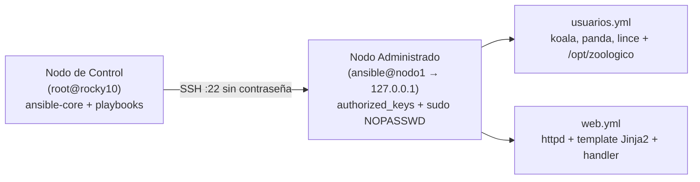
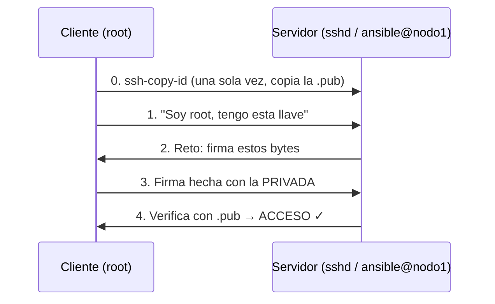

# Clase 6: SSH, Ansible y Automatización de Infraestructura

> **Asignatura:** Temas Selectos de Ingeniería en Computación - DevOps  
> **Tema principal:** Llaves SSH, transferencia de archivos (`scp`, `rsync`, `sftp`), automatización declarativa con Ansible, inventarios, comandos ad-hoc, playbooks, templates Jinja2 y handlers en Rocky Linux 10.

---

## 1. Resumen Ejecutivo de la Sesión

En esta sexta sesión abordamos la **automatización de infraestructura** usando SSH como protocolo base y Ansible como motor declarativo. El laboratorio ejecutó toda la práctica sobre **una sola VM Rocky Linux 10** que actúa simultáneamente como nodo de control (`root`) y nodo administrado (`ansible@nodo1 → 127.0.0.1`):



### Objetivos y Prácticas Clave:
1. **Llaves SSH**: Generación del par `ed25519`, copia con `ssh-copy-id`, diagnóstico de permisos con `StrictModes`.
2. **Transferencia de archivos**: `scp` (copia directa), `rsync` (diferencial), `sftp` (interactivo).
3. **Instalación de Ansible**: `dnf install -y ansible-core` (AppStream Rocky 10).
4. **Inventario e `ansible.cfg`**: Definición de grupos `[web]`, `[zoologico:children]`.
5. **Comandos ad-hoc**: `ping`, `setup` (facts), `dnf`, `user`, `service`.
6. **Idempotencia**: Comparativa `shell` vs `lineinfile`.
7. **Playbooks completos**: `usuarios.yml` (loop + SGID) y `web.yml` (template + handler).

---

## 2. Fundamentos SSH: Criptografía Asimétrica

SSH usa un par de llaves matemáticamente ligadas. La **privada** nunca sale del nodo de control; la **pública** se deposita en `~/.ssh/authorized_keys` del servidor.



### Paso a Paso en la VM

```bash
# 1. Crear usuario que simula el servidor remoto
useradd ansible
passwd ansible
echo "127.0.0.1   nodo1" >> /etc/hosts
getent hosts nodo1

# 2. Generar par de llaves en el nodo de control (root)
ssh-keygen -t ed25519 -C "root@control"
# → Enter, Enter (sin passphrase para el lab)
ls -l ~/.ssh/
# -rw-------. id_ed25519   (600 — privada)
# -rw-r--r--. id_ed25519.pub (644 — pública)

# 3. Copiar la pública al servidor — última vez que pide contraseña
ssh-copy-id ansible@nodo1

# 4. Acceso directo sin contraseña
ssh ansible@nodo1 hostname   # → entra sin pedir contraseña

# 5. Dar sudo sin contraseña al usuario ansible
echo 'ansible ALL=(ALL) NOPASSWD: ALL' > /etc/sudoers.d/ansible
chmod 0440 /etc/sudoers.d/ansible
visudo -cf /etc/sudoers.d/ansible   # valida antes de aplicar
```

> **Error clásico: permisos de `~/.ssh`**  
> `sshd` tiene `StrictModes yes`. Si los permisos son demasiado abiertos, ignora la llave en silencio.
> ```bash
> # Romper (a propósito para diagnosticar)
> chmod 777 /home/ansible/.ssh
> ssh ansible@nodo1   # ← vuelve a pedir contraseña
> ssh -v ansible@nodo1 2>&1 | grep -i "offering\|authentications"
> journalctl -u sshd -n 10 --no-pager
> # Authentication refused: bad ownership or modes for directory /home/ansible/.ssh
> chmod 700 /home/ansible/.ssh
> chmod 600 /home/ansible/.ssh/authorized_keys
> ```

---

## 3. Transferencia de Archivos: scp, rsync, sftp

| Herramienta | Uso ideal | Comportamiento |
| :--- | :--- | :--- |
| `scp` | Copia simple de un archivo o carpeta | Copia todo cada vez (`-r` para directorios) |
| `rsync` | Sincronización y respaldos repetidos | Solo transfiere diferencias; `--delete` borra extras |
| `sftp` | Sesión interactiva (GUI: WinSCP, FileZilla) | Comandos `get`, `put`, `ls`, `pwd`, `bye` |

```bash
# scp: local → remoto
echo "Reporte $(date)" > /root/reporte.txt
scp /root/reporte.txt ansible@nodo1:/home/ansible/

# scp: remoto → local
scp ansible@nodo1:/etc/os-release /tmp/os-release-nodo1

# rsync: solo lo que cambió (idempotente en la 2ª corrida)
dnf install -y rsync
rsync -avz /root/sitio/ ansible@nodo1:/home/ansible/respaldo/
rsync -avz /root/sitio/ ansible@nodo1:/home/ansible/respaldo/   # 2ª vez: 0 archivos

# ⚠️  Trampa clásica: la diagonal final
# /root/sitio/  → copia el CONTENIDO de sitio
# /root/sitio   → copia la CARPETA  → termina en respaldo/sitio/

# sftp: modo interactivo
sftp ansible@nodo1
sftp> pwd; ls
sftp> get reporte.txt /tmp/
sftp> bye
```

---

## 4. ¿Por qué Ansible y no un Script de Bash?

| Criterio | Script Bash | Ansible |
| :--- | :--- | :--- |
| **Idempotencia** | No: duplica líneas en cada ejecución | Sí: describe estado, no acciones |
| **Reporte** | No sabe qué cambió | `ok` / `changed` / `failed` por tarea |
| **Sin agente** | Requiere SSH manual | Solo SSH + Python en el nodo |
| **Legibilidad** | Requiere saber bash | YAML legible por cualquier rol |
| **Paralelo** | Loop manual | `forks = 5` por defecto |
| **Modo simulación** | No existe | `--check --diff` sin aplicar nada |

### Vocabulario Mínimo

| Término | Qué es | En nuestro lab |
| :--- | :--- | :--- |
| Nodo de control | Donde corre Ansible | `root` en la VM |
| Nodo administrado | Servidor configurado vía SSH | `ansible@nodo1` |
| Inventario | Lista de hosts y grupos | `inventario.ini` |
| Módulo | Unidad de trabajo (`dnf`, `user`, `copy`…) | `ansible.builtin.*` |
| Tarea | Llamada a un módulo con parámetros | "Instalar httpd" |
| Play / Playbook | Lista de tareas / archivo YAML con plays | `usuarios.yml`, `web.yml` |
| Handler | Tarea que corre solo si otra notificó un cambio | Reiniciar httpd |
| Facts | Datos descubiertos del host automáticamente | `ansible_facts['distribution']` |
| `become` | Escalar privilegios (`sudo`) | `-b` / `become: true` |

---

## 5. Instalación e Inventario

```bash
# Instalar Ansible (AppStream Rocky 10)
dnf install -y ansible-core
ansible --version

# Crear proyecto
mkdir -p /root/devops2026/ansible/templates
cd /root/devops2026/ansible
```

**`inventario.ini`:**
```ini
[web]
nodo1  ansible_host=127.0.0.1

[zoologico:children]
web
```

**`ansible.cfg`:**
```ini
[defaults]
inventory        = ./inventario.ini
remote_user      = ansible
host_key_checking = False
forks            = 5
```

```bash
# Verificar inventario
ansible --version | grep "config file"
ansible-inventory --graph
ansible all --list-hosts
```

---

## 6. Comandos Ad-hoc

**Sintaxis:** `ansible <hosts> -m <módulo> -a "<argumentos>" [-b]`

```bash
# 1. Conectividad (ping no es ICMP: prueba SSH + Python)
ansible all -m ansible.builtin.ping
# nodo1 | SUCCESS => { "changed": false, "ping": "pong" }

# 2. Facts del nodo
ansible nodo1 -m ansible.builtin.setup -a "filter=ansible_distribution*"
ansible nodo1 -m ansible.builtin.setup -a "filter=ansible_memtotal_mb"
ansible nodo1 -m ansible.builtin.command -a "df -h /"

# 3. Instalar paquete (con sudo)
ansible web -b -m ansible.builtin.dnf -a "name=tree state=present"
# 2ª vez: changed=false ← IDEMPOTENCIA

# 4. Idempotencia: shell (NO) vs lineinfile (SÍ)
ansible web -m ansible.builtin.shell -a "echo 'zona=aves' >> ~/notas.txt"
ansible web -m ansible.builtin.lineinfile -a "path=/home/ansible/notas2.txt line='zona=aves' create=true"
# Ejecutar 3 veces cada uno y comparar con: cat notas.txt; cat notas2.txt

# 5. Archivos, usuarios y servicios
ansible web -m ansible.builtin.copy -a "src=/root/reporte.txt dest=/home/ansible/reporte-ansible.txt mode=0640"
ansible web -b -m ansible.builtin.file -a "path=/opt/zoologico state=directory mode=0755"
ansible web -b -m ansible.builtin.user -a "name=koala comment='Cuidador koalas'"
ansible web -b -m ansible.builtin.user -a "name=koala state=absent remove=true"
ansible web -b -m ansible.builtin.service -a "name=sshd state=started enabled=true"

# 6. Documentación interna
ansible-doc -l | wc -l
ansible-doc ansible.builtin.user
ansible-doc -s ansible.builtin.lineinfile
```

---

## 7. Playbook 1 — `usuarios.yml` (Loop + SGID)

```yaml
---
- name: Cuidadores del zoológico
  hosts: web
  become: true
  vars:
    cuidadores:
      - koala
      - panda
      - lince
  tasks:
    - name: Crear grupo cuidadores
      ansible.builtin.group:
        name: cuidadores
        state: present

    - name: Crear usuarios
      ansible.builtin.user:
        name: "{{ item }}"
        groups: cuidadores
        append: true
        shell: /bin/bash
      loop: "{{ cuidadores }}"

    - name: Directorio compartido (SGID bit)
      ansible.builtin.file:
        path: /opt/zoologico
        state: directory
        group: cuidadores
        mode: "2770"
```

```bash
ansible-playbook usuarios.yml --syntax-check
ansible-playbook usuarios.yml
# PLAY RECAP → changed=3 (1ª corrida)

ansible-playbook usuarios.yml
# PLAY RECAP → changed=0 ← IDEMPOTENCIA CONFIRMADA

# Verificar
id panda                   # uid=3005(panda) gid=3005(panda) grupos=...cuidadores
ls -ld /opt/zoologico      # drwxrws---. 2 root cuidadores
```

> **Conexión con clases anteriores:** El modo `2770` activa el bit SGID (visto en permisos Linux, Clase 2). Los archivos creados en `/opt/zoologico` heredan el grupo `cuidadores` automáticamente. Ansible no inventa nada nuevo: **automatiza lo que ya sabes hacer**.

---

## 8. Playbook 2 — `web.yml` (Template Jinja2 + Handler)

**`web.yml`:**
```yaml
---
- name: Sitio del zoológico
  hosts: web
  become: true
  vars:
    titulo: "Zoológico DevOps 2026"
  tasks:
    - name: Instalar httpd
      ansible.builtin.dnf:
        name: httpd
        state: present

    - name: Publicar index.html desde plantilla
      ansible.builtin.template:
        src: templates/index.html.j2
        dest: /var/www/html/index.html
        owner: root
        group: root
        mode: "0644"
      notify: Reiniciar httpd

    - name: Crear página de salud (reto de clase)
      ansible.builtin.copy:
        dest: /var/www/html/salud.html
        content: "OK\n"
        mode: "0644"

    - name: httpd iniciado y habilitado
      ansible.builtin.service:
        name: httpd
        state: started
        enabled: true

  handlers:
    - name: Reiniciar httpd
      ansible.builtin.service:
        name: httpd
        state: restarted
```

**`templates/index.html.j2`:**
```jinja
<html>
  <body style="font-family:monospace;background:#111;color:#5af78e">
    <h1>{{ titulo }}</h1>
    <p>Servidor: {{ ansible_facts['hostname'] }}</p>
    <p>SO: {{ ansible_facts['distribution'] }} {{ ansible_facts['distribution_version'] }}</p>
    <p>Memoria: {{ ansible_facts['memtotal_mb'] }} MB</p>
    <p>Desplegado por Ansible</p>
  </body>
</html>
```

```bash
# Secuencia de demo
ansible-playbook web.yml --check --diff    # 1. ¿qué haría? (sin aplicar)
ansible-playbook web.yml                   # 2. aplica: changed + handler corre
curl -s localhost:8088                     # 3. verifica la página
curl -s localhost:8088/salud.html          # → OK
ansible-playbook web.yml                   # 4. changed=0 → handler NO corre
ansible-playbook web.yml -e "titulo='Clase 6 - DevOps 2026'" --diff
# 5. solo el template cambia → handler reinicia
```

---

## 9. Resultado de la Ejecución en Clase

| Playbook | 1ª corrida `changed` | 2ª corrida `changed` | Estado |
| :--- | :---: | :---: | :--- |
| `usuarios.yml` | 3 | 0 | ✅ Idempotente |
| `web.yml` | 3 (+ handler) | 0 | ✅ Idempotente |

```
PLAY RECAP (usuarios.yml 2ª corrida):
nodo1 : ok=4  changed=0  unreachable=0  failed=0

PLAY RECAP (web.yml 1ª corrida):
nodo1 : ok=6  changed=3  unreachable=0  failed=0
```
