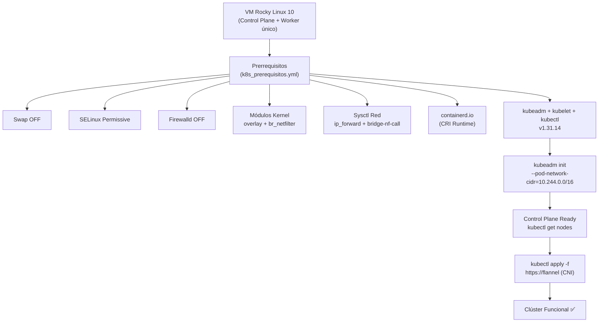
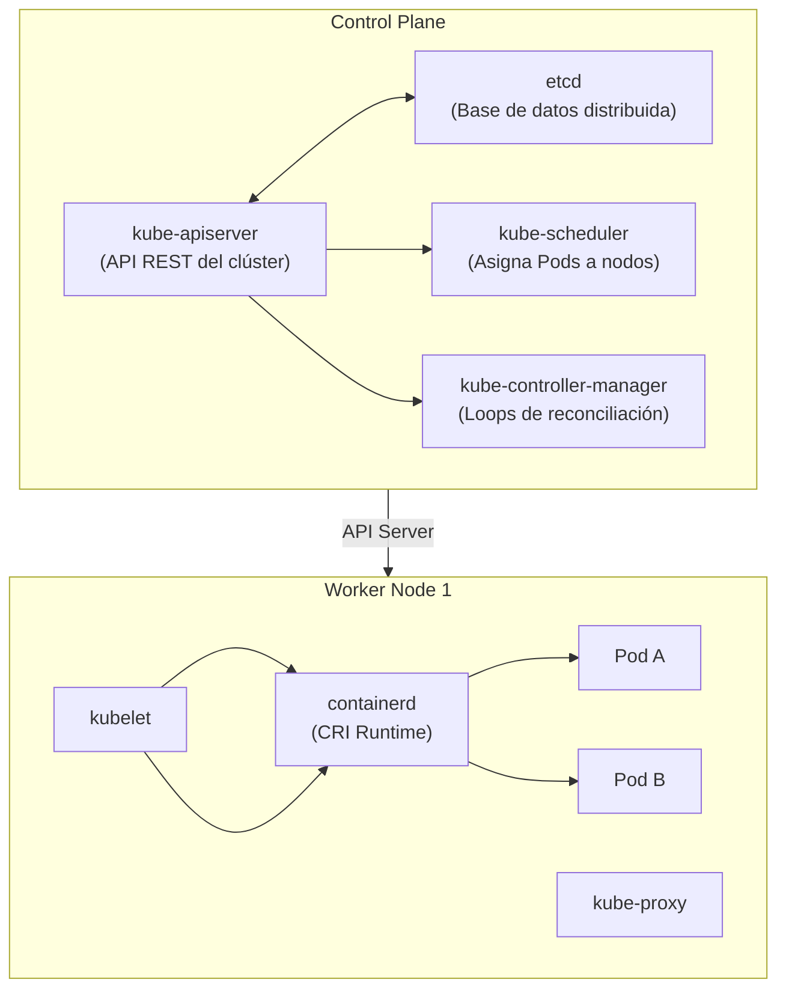

# Clase 7: Kubernetes — Prerrequisitos, Arquitectura e Instalación del Clúster

> **Asignatura:** Temas Selectos de Ingeniería en Computación - DevOps  
> **Tema principal:** Orquestación de contenedores con Kubernetes: arquitectura Control Plane / Worker, prerrequisitos del sistema automatizados con Ansible (`k8s_prerequisitos.yml`), instalación de `containerd`, `kubeadm`, `kubelet` y `kubectl` en Rocky Linux 10.  
> **Referencia:** [Kubernetes Installation on RHEL 9 (weeklycloud)](https://medium.com/weeklycloud/kubernetes-installation-on-rhel-9-d5629f2fa4f9)

---

## 1. Resumen Ejecutivo de la Sesión



---

## 2. ¿Por Qué Kubernetes? Podman/Docker vs Orquestador

Cuando el número de contenedores crece, la gestión manual se vuelve inmanejable:

| Característica | Podman / Docker solo | Kubernetes |
| :--- | :--- | :--- |
| **Autorecuperación** | Manual (`podman restart`) | Reinicia Pods automáticamente |
| **Escalado** | Manual | `kubectl scale --replicas=10` |
| **Balanceo de carga** | Externo manual | Service (`ClusterIP`, `NodePort`) nativo |
| **Actualizaciones sin tiempo de caída** | Manual / Docker Compose | Rolling Update declarativo |
| **Autodescubrimiento** | Configurar DNS manualmente | DNS interno (`CoreDNS`) automático |
| **Almacenamiento** | Volúmenes locales | PV / PVC / StorageClass abstracto |
| **Multi-nodo** | Compose en un nodo | Clúster de N nodos con scheduler |

---

## 3. Arquitectura de Kubernetes



| Componente | Rol |
| :--- | :--- |
| `kube-apiserver` | Punto de entrada de todas las operaciones. `kubectl` habla solo con él. |
| `etcd` | Base de datos clave-valor distribuida. Almacena el estado deseado del clúster. |
| `kube-scheduler` | Decide en qué nodo corre cada Pod según recursos disponibles. |
| `kube-controller-manager` | Garantiza que el estado actual coincida con el estado deseado (ReplicaSet, Node…). |
| `kubelet` | Agente en cada nodo. Recibe órdenes del API Server y gestiona los Pods vía CRI. |
| `kube-proxy` | Mantiene las reglas de red (`iptables`/`ipvs`) para el tráfico de Services. |
| `containerd` | Runtime de contenedores compatible con CRI (reemplaza Docker desde K8s 1.24). |

---

## 4. Prerrequisitos del Sistema (y por qué cada uno)

| Prerrequisito | Razón |
| :--- | :--- |
| **Desactivar Swap** | `kubelet` necesita garantía de RAM física real. Con swap activa, el scheduler pierde precisión y los contenedores pueden moverse lentamente a disco. |
| **SELinux Permissive** | Las políticas predeterminadas de RHEL/Rocky bloquean el acceso de contenedores a filesystems del host. En permisivo solo registra, sin bloquear. |
| **Firewalld OFF** | En laboratorio, `firewalld` bloquea puertos críticos: API Server (6443), etcd (2379-2380), kubelet (10250). En producción se abren explícitamente. |
| **Módulo `overlay`** | Necesario para OverlayFS, el sistema de capas de almacenamiento de contenedores. |
| **Módulo `br_netfilter`** | Permite que los paquetes que cruzan bridges virtuales sean procesados por `iptables`. |
| **Sysctl `ip_forward`** | Habilita el reenvío de paquetes IPv4 entre interfaces (esencial para el tráfico Pod-a-Pod). |
| **Sysctl `bridge-nf-call-iptables`** | Permite que el tráfico en bridges sea filtrado por `iptables`. |
| **`containerd` + `SystemdCgroup`** | Desde K8s 1.24 no usa Docker. `SystemdCgroup = true` sincroniza la jerarquía de cgroups con systemd. |
| **`kubeadm/kubelet/kubectl`** | El trío oficial: inicializar, agente de nodo y CLI de administración. |

---

## 5. Tarea: Playbook `k8s_prerequisitos.yml`

Archivo guardado en `/root/devops2026/ansible/k8s_prerequisitos.yml` y en [`Clase 7/k8s_prerequisitos.yml`](./k8s_prerequisitos.yml).

### Resultado de la Ejecución (1ª corrida)

```
PLAY [Preparar nodo RHEL 9 / Rocky Linux 9 para Kubernetes] *****

TASK [1.1 Desactivar Swap]              changed
TASK [1.2 Comentar Swap en /etc/fstab]  changed
TASK [2.1 SELinux config permissive]    changed
TASK [2.2 setenforce 0]                 changed
TASK [3.1 Detener firewalld]            changed
TASK [4.1 Módulos overlay/br_netfilter] changed
TASK [4.2 modprobe overlay]             ok
TASK [4.3 modprobe br_netfilter]        ok
TASK [5.1 Sysctl k8s.conf]              changed
TASK [6.1 dnf-plugins-core + iproute]   ok
TASK [6.2 Repo docker-ce.repo]          changed
TASK [6.3 Instalar containerd.io]       changed
TASK [6.4 Directorio /etc/containerd]   ok
TASK [6.5 config.toml default]          ok
TASK [6.6 SystemdCgroup = true]         ok
TASK [6.7 containerd started/enabled]   changed
TASK [7.1 Repo kubernetes.repo]         changed
TASK [7.2 kubelet+kubeadm+kubectl]      changed
TASK [7.3 Habilitar kubelet]            changed
HANDLER [Aplicar sysctl --system]       changed

PLAY RECAP: ok=21  changed=14  unreachable=0  failed=0
```

### Resultado de la 2ª corrida (Idempotencia)

```
PLAY RECAP: ok=19  changed=1  unreachable=0  failed=0  skipped=1
# El único changed=1 es setenforce 0 (normal, no persiste entre corridas sin reinicio)
# skipped=1 → Swap ya estaba en 0, se omite la tarea 1.1
```

---

## 6. Verificación de Prerrequisitos (Evidencias)

```bash
# 1. Swap apagada
swapon --show         # → (vacío)
free -m               # Swap: 0  0  0

# 2. SELinux permissive
getenforce            # → Permissive

# 3. Módulos del kernel
lsmod | grep -E "overlay|br_netfilter"
# br_netfilter  36864  0
# overlay       245760  0

# 4. Parámetros de red
sysctl net.bridge.bridge-nf-call-iptables net.ipv4.ip_forward
# net.bridge.bridge-nf-call-iptables = 1
# net.ipv4.ip_forward = 1

# 5. containerd activo
systemctl is-active containerd         # → active
systemctl status containerd --no-pager

# 6. Herramientas Kubernetes
kubeadm version --output=short         # → v1.31.14
kubectl version --client --short       # → Kubernetes v1.31.14
kubelet --version                      # → Kubernetes v1.31.14
```

---

## 7. Material de Apoyo del Profesor: `kubernetes.zip`

El archivo comprimido contiene ejercicios para las **clases finales** del módulo de Kubernetes. Está organizado en la carpeta [`Clase 7/kubernetes/`](./kubernetes/):

| Carpeta / Archivo | Contenido |
| :--- | :--- |
| `00-overview.md` | Mapa conceptual del módulo de Kubernetes |
| `01-namespace/` | Namespaces: aislamiento lógico del clúster |
| `02-pod/` | Pod básico, multi-contenedor e init containers |
| `03-configmap/` | ConfigMaps como env vars y volúmenes |
| `04-secret/` | Secrets (base64): contraseñas y tokens |
| `05-serviceaccount/` | RBAC: ServiceAccounts, Roles y RoleBindings |
| `06-deployment/` | Deployments con RollingUpdate y Rollback |
| `07-service/` | ClusterIP, NodePort y LoadBalancer |
| `08-ejercicio-integrador/` | App completa: Deployment + Service + ConfigMap |
| `09-storage-intro/` | EmptyDir y HostPath |
| `10-pv-pvc/` | PersistentVolume y PersistentVolumeClaim |
| `11-storageclass-nfs-csi/` | StorageClass dinámica con NFS-CSI |
| `12-statefulset/` | StatefulSet para bases de datos (PostgreSQL) |
| `13-daemonset/` | DaemonSet para agentes de log en todos los nodos |
| `monitoring/` | Prometheus + Grafana + kube-state-metrics |
| `tekton-argocd/` | Pipeline CI/CD con Tekton y GitOps con ArgoCD |
| `tracing-network/` | Jaeger (tracing), Tempo y NetworkPolicies |
| `cheatsheet.md` | Referencia rápida de comandos `kubectl` |

---

## 8. Siguiente Paso: Inicializar el Clúster

Una vez que los prerrequisitos están instalados (tarea ya completada), el siguiente paso es:

```bash
# En el nodo Control Plane:
kubeadm init --pod-network-cidr=10.244.0.0/16

# Configurar kubectl para root
mkdir -p $HOME/.kube
cp -i /etc/kubernetes/admin.conf $HOME/.kube/config
chown $(id -u):$(id -g) $HOME/.kube/config

# Instalar plugin de red (Flannel)
kubectl apply -f https://raw.githubusercontent.com/flannel-io/flannel/master/Documentation/kube-flannel.yml

# Verificar que el nodo está listo
kubectl get nodes
# NAME                     STATUS   ROLES           AGE   VERSION
# localhost.localdomain   Ready    control-plane   ...   v1.31.14

# Ver todos los Pods del sistema
kubectl get pods -A
```

> **Nota de Laboratorio:** Con una sola VM actuando como Control Plane, es posible hacer que también actúe como Worker ejecutando:
> ```bash
> kubectl taint nodes --all node-role.kubernetes.io/control-plane-
> ```
> Para un clúster con Control Plane + Worker separados, se necesita una segunda VM y se une con el comando `kubeadm join` que genera el `kubeadm init`.

