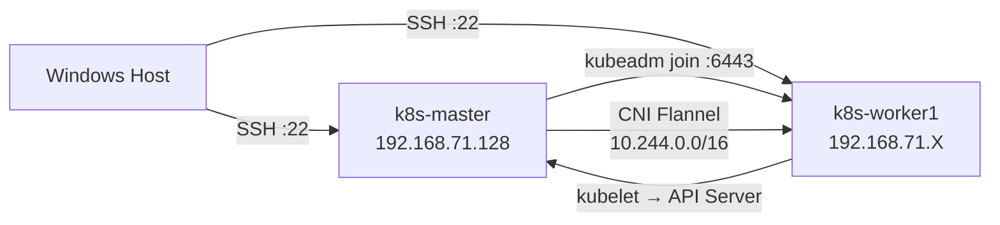

# Clase 8 — Kubernetes: Clúster Multi-Nodo y Objetos Avanzados

> **Materia:** DevOps — Temas Selectos  
> **Fecha:** Noviembre 2026  
> **VM:** Rocky Linux 10 | IP Control Plane: `192.168.71.128` (VMware NAT)  
> **Versión K8s:** v1.31.14 | Container Runtime: containerd  
> **Temas:** Clúster multi-nodo con `kubeadm`, CNI Flannel, Labs 01-06, Ejercicio Integrador

---

## 1. Arquitectura del Clúster Kubernetes

Un clúster Kubernetes en producción separa los roles en al menos dos tipos de nodo:

| Nodo | Rol | Responsabilidad |
|:---|:---|:---|
| **Control Plane (Master)** | Orquestador | API Server, etcd, Scheduler, Controller Manager |
| **Worker Node** | Ejecutor | Kubelet, Kube-Proxy, Container Runtime, Pods de usuario |

### Topología de Red con VMware (2 VMs)

Para construir un clúster multi-nodo en VMware Workstation se necesitan **dos VMs** con red compartida:

```
┌─────────────────────────────────────┐
│         Windows Host                │
│                                     │
│  ┌──────────────┐  ┌─────────────┐  │
│  │  k8s-master  │  │ k8s-worker1 │  │
│  │192.168.71.128│  │192.168.71.X │  │
│  │ Control Plane│  │  Worker Node│  │
│  └──────┬───────┘  └──────┬──────┘  │
│         └────────┬─────────┘         │
│              VMnet8 (NAT)            │
└─────────────────────────────────────┘
```

> **Punto clave:** En VMware, ambas VMs en la misma red NAT (VMnet8) pueden comunicarse entre sí y con el host. No se requiere adaptador Host-Only adicional (a diferencia de VirtualBox).



---

## 2. Preparación: Clonar la VM Worker

A partir de la VM `DevOps` (Rocky Linux ya configurada con todos los prerequisitos de K8s):

1. **Apagar la VM master:** `poweroff`
2. En VMware Workstation → `VM > Manage > Clone`
3. Tipo: **Full Clone** (clon completo independiente)
4. Nombre: `Rocky-Linux-DevOps-Worker`
5. **Generar nuevas MAC addresses** (crítico para evitar conflictos de red)

### Configurar identidad de los nodos

En el **Master** (`192.168.71.128`):
```bash
hostnamectl set-hostname k8s-master
echo "192.168.71.128  k8s-master" >> /etc/hosts
echo "192.168.71.X    k8s-worker1" >> /etc/hosts   # Reemplaza X con la IP real del worker
```

En el **Worker** (IP asignada por DHCP VMware, revisar con `ip a`):
```bash
hostnamectl set-hostname k8s-worker1
echo "192.168.71.128  k8s-master" >> /etc/hosts
echo "192.168.71.X    k8s-worker1" >> /etc/hosts
```

---

## 3. Verificar Prerequisitos en Ambos Nodos

El playbook `k8s_prerequisitos.yml` debe ejecutarse en **ambos nodos** antes de inicializar el clúster:

```bash
# En el master, actualizar inventario con ambos nodos:
cat /root/devops2026/ansible/inventario.ini
```

```ini
[control_plane]
k8s-master ansible_host=192.168.71.128

[workers]
k8s-worker1 ansible_host=192.168.71.X

[k8s:children]
control_plane
workers
```

```bash
# Ejecutar playbook en todos los nodos:
cd /root/devops2026/ansible
ansible-playbook k8s_prerequisitos.yml -i inventario.ini
```

**Resultado esperado:**
```text
PLAY RECAP *************************************************************
k8s-master    : ok=19   changed=1    unreachable=0    failed=0
k8s-worker1   : ok=19   changed=14   unreachable=0    failed=0
```

> **Punto clave:** Los prerequisitos (swap OFF, SELinux permisivo, módulos kernel, containerd, kubeadm/kubelet/kubectl) deben estar en **ambos** nodos antes de continuar.

---

## 4. Inicialización del Control Plane (Master)

```bash
# En el nodo MASTER:
kubeadm init \
  --apiserver-advertise-address=192.168.71.128 \
  --pod-network-cidr=10.244.0.0/16
```

| Parámetro | Valor | Descripción |
|:---|:---|:---|
| `--apiserver-advertise-address` | `192.168.71.128` | IP del master para el API Server |
| `--pod-network-cidr` | `10.244.0.0/16` | Requerido por Flannel CNI |

### Configurar kubectl en el Master:
```bash
mkdir -p $HOME/.kube
cp -i /etc/kubernetes/admin.conf $HOME/.kube/config
chown $(id -u):$(id -g) $HOME/.kube/config
```

### Verificar que el master está listo:
```bash
kubectl get nodes
# NAME         STATUS     ROLES           AGE   VERSION
# k8s-master   NotReady   control-plane   1m    v1.31.14
# (NotReady hasta instalar CNI)
```

---

## 5. Despliegue de la Red de Pods (CNI — Flannel)

Sin un plugin de red (CNI), los nodos quedan en `NotReady`. Flannel es la solución más común para laboratorios:

```bash
# En el nodo MASTER:
kubectl apply -f https://github.com/flannel-io/flannel/releases/latest/download/kube-flannel.yml
```

**Verificar que Flannel está corriendo:**
```bash
kubectl get pods -n kube-flannel
# NAME                    READY   STATUS    RESTARTS   AGE
# kube-flannel-ds-xxxxx   1/1     Running   0          30s
```

**Después de Flannel, el master pasa a Ready:**
```bash
kubectl get nodes
# NAME         STATUS   ROLES           AGE   VERSION
# k8s-master   Ready    control-plane   3m    v1.31.14
```

---

## 6. Unión del Nodo Worker al Clúster

Al finalizar `kubeadm init`, se muestra el comando `kubeadm join`. Copiarlo y ejecutarlo **en el Worker**:

```bash
# En el nodo WORKER:
kubeadm join 192.168.71.128:6443 \
  --token <TOKEN_GENERADO> \
  --discovery-token-ca-cert-hash sha256:<HASH_GENERADO>
```

> **Si se pierde el token**, regenerarlo en el Master:
> ```bash
> kubeadm token create --print-join-command
> ```

### Verificar el clúster completo (en Master):
```bash
kubectl get nodes -o wide
# NAME          STATUS   ROLES           AGE   VERSION    INTERNAL-IP      
# k8s-master    Ready    control-plane   10m   v1.31.14   192.168.71.128   
# k8s-worker1   Ready    <none>          2m    v1.31.14   192.168.71.X
```

```bash
kubectl get pods -n kube-system
# Todos los pods deben estar en Running:
# coredns, etcd, flannel, kube-apiserver, kube-proxy, kube-scheduler, kube-controller-manager
```

---

## 7. Laboratorios de Kubernetes (Clase 8)

### Lab 01 — Namespaces

**¿Qué es un Namespace?** Partición lógica del clúster para aislar recursos por entorno o equipo.

```bash
# Declarativo (con YAML):
kubectl apply -f /root/kubernetes/01-namespace/namespace.yaml

# Imperativo:
kubectl create namespace dev
kubectl create namespace prod

# Listar todos:
kubectl get namespaces

# Fijar namespace por defecto:
kubectl config set-context --current --namespace=bootcamp
```

---

### Lab 02 — Pods (Básico, Sidecar, Init Container)

**Pod básico:**
```bash
kubectl apply -f /root/kubernetes/02-pods/01-pod-basico.yaml
kubectl get pods -o wide       # Ver en qué nodo fue programado
kubectl describe pod nginx-pod # Ver eventos y scheduling
kubectl logs nginx-pod
kubectl delete pod nginx-pod
```

**Patrón Sidecar** — Dos contenedores en un Pod compartiendo volumen `emptyDir`:
```yaml
# El contenedor principal escribe logs, el sidecar los lee
volumes:
  - name: shared-logs
    emptyDir: {}
```
```bash
kubectl logs pod-sidecar -c log-writer
kubectl logs pod-sidecar -c log-reader
```

**Patrón Init Container** — Precondición antes del contenedor principal:
```bash
kubectl get pod pod-con-init     # Fase: PodInitializing → Running
kubectl describe pod pod-con-init # Ver secuencia de Init
```

---

### Lab 03 — ConfigMaps y Hot Reload

```bash
# Crear ConfigMap:
kubectl apply -f /root/kubernetes/03-configmap/configmap.yaml
kubectl get configmap mi-config -o yaml

# Consumo como variable de entorno (estático — requiere reinicio):
kubectl exec pod-env -- env | grep APP_ENV

# Consumo como volumen (Hot Reload — dinámico):
kubectl exec pod-vol -- cat /etc/config/app.properties
```

> **Punto clave:** Variables de entorno → estáticas (requieren reinicio del Pod para actualizarse). Volúmenes montados → Hot Reload automático en ~60s.

---

### Lab 04 — Secrets

```bash
# Crear Secret:
kubectl apply -f /root/kubernetes/04-secrets/secret.yaml

# Ver Secret (codificado en Base64 — NO es cifrado):
kubectl get secret mi-secret -o yaml

# Decodificar desde terminal:
echo "c3VwZXItc2VjcmV0" | base64 --decode

# Verificar inyección dentro del Pod:
kubectl exec pod-secreto -- env | grep API_KEY
```

> **Punto clave:** Base64 NO es cifrado. Para producción, usar Sealed Secrets, Vault o External Secrets Operator.

---

### Lab 05 — ServiceAccount y RBAC

```bash
# Crear SA, Role y RoleBinding:
kubectl apply -f /root/kubernetes/05-serviceaccount/rbac.yaml

# Verificar permisos con can-i:
kubectl auth can-i list pods --as=system:serviceaccount:bootcamp:mi-app-sa -n bootcamp
kubectl auth can-i delete pods --as=system:serviceaccount:bootcamp:mi-app-sa -n bootcamp
```

| Objeto RBAC | Función |
|:---|:---|
| `ServiceAccount` | Identidad del Pod dentro del clúster |
| `Role` | Define qué acciones se permiten en qué recursos (en un namespace) |
| `RoleBinding` | Vincula un Role a una ServiceAccount |
| `ClusterRole` | Como Role pero a nivel de todo el clúster |

---

### Lab 06 — Deployments, Escalado y Rollback

```bash
# Desplegar:
kubectl apply -f /root/kubernetes/06-deployment/deployment.yaml

# Escalar:
kubectl scale deployment nginx-deployment --replicas=5
kubectl get pods -o wide   # Ver distribución en nodos

# Rolling Update (actualizar imagen):
kubectl set image deployment/nginx-deployment nginx=nginx:1.25
kubectl rollout status deployment/nginx-deployment

# Historial de versiones:
kubectl rollout history deployment/nginx-deployment

# Rollback:
kubectl rollout undo deployment/nginx-deployment
kubectl rollout undo deployment/nginx-deployment --to-revision=1
```

> **Punto clave:** Rolling Update reemplaza Pods gradualmente (sin downtime). Rollback revierte inmediatamente a la revisión anterior.

---

## 8. Lab 08 — Ejercicio Integrador (`todo-en-uno.yaml`)

Despliegue completo de una aplicación con todos los objetos K8s en un solo manifiesto:

```
Namespace: mi-app
├── ServiceAccount (mi-app-sa)
├── ConfigMap (mi-app-config) → Monta /usr/share/nginx/html/index.html
├── Secret (mi-app-secret)    → Inyecta $API_KEY
├── Deployment (3 réplicas)   → Pods distribuidos en nodos
└── Service NodePort (:30090) → Acceso web desde exterior
```

```bash
# Desplegar:
cd /root/kubernetes/08-ejercicio-integrador
kubectl apply -f todo-en-uno.yaml

# Verificar todos los recursos:
kubectl get all -n mi-app -o wide

# Verificar rollout:
kubectl rollout status deployment/mi-app-deployment -n mi-app

# Verificar variables inyectadas:
POD=$(kubectl get pods -n mi-app -l app=mi-app -o jsonpath='{.items[0].metadata.name}')
kubectl exec -n mi-app $POD -- env | grep -E 'APP_ENV|API_KEY'

# Acceso web:
curl http://192.168.71.128:30090
```

**Pruebas de resiliencia:**
```bash
# Eliminar un pod (self-healing):
kubectl delete pod $POD -n mi-app
kubectl get pods -n mi-app   # Deployment regenera automáticamente

# Escalar a 5 réplicas:
kubectl scale deployment mi-app-deployment --replicas=5 -n mi-app
```

---

## 9. Incidencias Comunes y Soluciones

| Incidencia | Causa | Solución |
|:---|:---|:---|
| `kubeadm: 0 bytes` | Binario corrupto por corte de red durante DNF | `dnf reinstall -y kubelet kubeadm kubectl --disableexcludes=kubernetes` |
| `crictl: Violación de segmento` | Binario `crictl` dañado | `dnf reinstall -y cri-tools --disableexcludes=kubernetes` |
| `no space left on device` | Partición `/var` llena (< 1 GB) | Mover `/var/lib/containerd` a partición raíz con symlink |
| Nodo en `NotReady` | CNI no instalado | `kubectl apply -f kube-flannel.yml` |
| Token de join expirado | Token válido 24h solamente | `kubeadm token create --print-join-command` en master |
| SSH timeout con red inalámbrica | Client Isolation en red corporativa | Usar VMware NAT o VirtualBox Host-Only |

---

## 10. Comandos de Verificación Final

```bash
# Estado del clúster completo:
kubectl get nodes -o wide
kubectl get pods -A

# Verificar componentes del sistema:
kubectl get pods -n kube-system
kubectl get pods -n kube-flannel

# Swap apagada:
free -m && swapon --show

# SELinux permisivo:
getenforce

# Parámetros de red:
sysctl net.bridge.bridge-nf-call-iptables net.ipv4.ip_forward

# Versiones:
kubeadm version
kubectl version --client
kubelet --version
containerd --version
```

