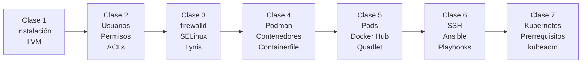

# Resumen Completo del Curso: Temas Selectos de Ingeniería en Computación — DevOps 2026

> **Institución:** Facultad de Ingeniería, UNAM  
> **Plataforma:** Rocky Linux 10.2 en VMware Workstation Pro (NAT, 1 VM)  
> **Conexión:** SSH desde Windows → `root@192.168.71.128`  
> **Repositorio:** [davidm-afk/DevOps-Temas-Selectos](https://github.com/davidm-afk/DevOps-Temas-Selectos)

---

## Mapa del Curso



---

## Clase 1 — Instalación de Rocky Linux y Administración de LVM

**Tema principal:** Instalación del sistema operativo en VMware, particionado manual y gestión dinámica del almacenamiento con LVM (Logical Volume Manager).

### Conceptos Clave

**LVM** introduce una capa de abstracción entre el hardware físico y el sistema de archivos:

```
Disco Físico (PV) → Grupo de Volúmenes (VG) → Volúmenes Lógicos (LV) → Sistema de Archivos
```

| Capa | Elemento | Descripción |
| :--- | :--- | :--- |
| **PV** | Physical Volume | Partición o disco declarado para LVM (`pvcreate`) |
| **VG** | Volume Group | Pool de almacenamiento (`vgcreate`, `vgextend`) |
| **LV** | Logical Volume | "Partición virtual" redimensionable (`lvcreate`, `lvextend`) |

### Esquema de Particionado Inicial

| Punto de Montaje | Tamaño | Tipo | Propósito |
| :--- | :--- | :--- | :--- |
| `biosboot` | 1 MiB | Standard | Arranque GPT/BIOS |
| `/boot` | 1 GiB | Standard | Kernel + GRUB |
| `/` | 4 GiB | LVM (`rlm`) | Raíz del sistema |
| `/home` | 1 GiB | LVM | Directorios de usuarios |
| `/tmp` | 1 GiB | LVM | Archivos temporales |
| `/var` | 1 GiB | LVM | Logs y bases de datos |
| `swap` | 1 GiB | LVM | Memoria de intercambio |

**~11 GiB** quedaron sin asignar para los ejercicios de LVM en caliente.

### Comandos Clave

```bash
lsblk; pvs; vgs; lvs; df -hT
fdisk /dev/sdb           # Nueva partición tipo 8e (Linux LVM)
pvcreate /dev/sdb1
vgextend rlm /dev/sdb1
lvextend -L +5G /dev/rlm/root
xfs_growfs /             # XFS: resize online
lvcreate -L 2G -n datos rlm
mkfs.xfs /dev/rlm/datos
echo "/dev/rlm/datos  /datos  xfs  defaults  0 0" >> /etc/fstab
mount -a
```

> **Punto clave:** A diferencia de particiones clásicas, LVM permite redimensionar volúmenes **en caliente** sin desmontar el sistema de archivos.

---

## Clase 2 — Usuarios, Grupos, Permisos, ACLs y Repositorios DNF

**Tema principal:** Gestión completa de identidades y permisos en Linux, desde los archivos del sistema hasta ACLs granulares.

### Archivos del Sistema de Identidad

| Archivo | Contenido | Formato |
| :--- | :--- | :--- |
| `/etc/passwd` | Cuentas de usuario | `usuario:x:UID:GID:comentario:home:shell` |
| `/etc/shadow` | Hashes de contraseñas | `usuario:hash:fecha:min:max:...` |
| `/etc/group` | Grupos y miembros | `grupo:x:GID:miembro1,miembro2` |

### Permisos POSIX y Bits Especiales

| Permiso Especial | Valor Octal | Efecto en Directorios |
| :--- | :--- | :--- |
| `SUID` | `4xxx` | (raro en dirs) |
| `SGID` | `2xxx` | Nuevos archivos heredan el grupo |
| `Sticky` | `1xxx` | Solo el dueño puede borrar sus archivos |

### Comandos Clave

```bash
useradd -u 2001 -g felinos -s /bin/bash puma
groupadd -g 5001 felinos
usermod -aG aves halcon         # Agregar grupo secundario
chmod 2770 /zoo/felinos         # SGID: nuevos archivos heredan grupo
umask 022                       # Máscara por defecto
setfacl -m u:aguila:rx /zoo/felinos   # ACL granular
getfacl /zoo/felinos
setfacl -b /zoo/felinos         # Borrar todas las ACLs
```

---

## Clase 3 — firewalld, SELinux y Auditoría con Lynis

**Tema principal:** Defensa en profundidad: firewall de red basado en zonas, control de acceso obligatorio (MAC) con SELinux y auditoría técnica de hardening.

### Modelo de Capas de Seguridad

```
Internet → [1. firewalld] → [2. DAC: permisos POSIX] → [3. SELinux: MAC] → Servicio → [4. Lynis: auditoría]
```

### firewalld: Zonas y Reglas

```bash
firewall-cmd --get-active-zones
firewall-cmd --zone=public --list-all
firewall-cmd --permanent --zone=public --add-service=http
firewall-cmd --permanent --zone=public --add-port=8080/tcp
firewall-cmd --reload
# Rate limiting anti-fuerza bruta SSH
firewall-cmd --permanent --zone=public --add-rich-rule='
  rule family="ipv4" service name="ssh" limit value="3/m" accept'
```

### SELinux

| Modo | Comportamiento |
| :--- | :--- |
| `Enforcing` | Bloquea y registra violaciones |
| `Permissive` | Solo registra (diagnóstico) |
| `Disabled` | Sin protección (nunca en producción) |

```bash
getenforce; setenforce 0
ls -Z /var/www/html/
semanage fcontext -a -t httpd_sys_content_t '/datos/web(/.*)?'
restorecon -Rv /datos/web/
semanage port -a -t http_port_t -p tcp 8443
audit2why < /var/log/audit/audit.log
```

### Lynis

```bash
dnf install -y lynis
lynis audit system
# Hardening Index: 0-100 (objetivo en producción: > 65)
```

> **Concepto clave:** Si un atacante explota una vulnerabilidad en Apache, SELinux lo confina en el dominio `httpd_t`. Aunque el proceso corra como root, el kernel le prohíbe leer `/etc/shadow` o ejecutar shells de administración.

---

## Clase 4 — Contenedores con Podman, Redes y Containerfiles

**Tema principal:** Arquitectura Daemonless de Podman, ciclo de vida de contenedores, redes personalizadas bridge, volúmenes persistentes y construcción de imágenes con `Containerfile`.

### Podman vs Docker

| Criterio | Docker | Podman |
| :--- | :--- | :--- |
| **Demonio** | `dockerd` siempre activo como root | **Daemonless**: fork/exec directo |
| **Seguridad** | Socket equivale a root | **Rootless** nativo por usuario |
| **systemd** | Integración complicada | Genera units nativos (Quadlet) |
| **Pods** | Solo con Swarm/Compose | Nativo (`podman pod create`) |

### Comandos Clave

```bash
podman pull docker.io/library/nginx:latest
podman run -dit --name nginx01 -p 8080:80 nginx:latest
podman exec -it nginx01 bash
podman stop nginx01; podman rm nginx01

# Redes personalizadas
podman network create --subnet 10.89.0.0/16 prod
podman run -dit --name app --network prod nginx:latest

# Volúmenes persistentes
podman volume create db-datos
podman run -dit -v db-datos:/var/lib/postgresql/data postgres:latest

# Containerfile
podman build -t py-web:1.0 .
podman run -dit --name web -p 8080:8080 py-web:1.0
```

### Estructura de un `Containerfile`

```dockerfile
FROM python:3.11-slim          # Imagen base oficial slim
WORKDIR /app
COPY server.py .               # Copiar solo lo necesario
RUN useradd -u 1001 appuser   # Usuario sin privilegios
USER appuser                   # Nunca root en producción
EXPOSE 8080
CMD ["python", "server.py"]
```

---

## Clase 5 — Pods en Podman, Docker Hub y Quadlet/systemd

**Tema principal:** Concepto de Pod, ejercicio integrador de microservicios, publicación en Docker Hub y arranque automático con Quadlet.

### ¿Qué es un Pod?

Un Pod es un grupo de contenedores que comparten **Network**, **IPC** y **UTS** namespaces. El **contenedor infra** (`podman-pause`) sostiene los namespaces aunque los contenedores de aplicación fallen.

```bash
podman pod create --name lab-pod -p 8080:8080
podman run -dit --pod lab-pod --name lab-api py-web:1.0
podman run -dit --pod lab-pod --name lab-db pg-usuarios:1.0
podman pod ps
podman pod stop lab-pod; podman pod rm -f lab-pod

# Docker Hub
podman login docker.io
podman tag py-web:1.0 docker.io/tu-usuario/py-web:1.0
podman push docker.io/tu-usuario/py-web:1.0

# Quadlet: arranque con systemd
mkdir -p ~/.config/containers/systemd/
# Crear .pod y .container en ese directorio
systemctl --user daemon-reload
systemctl --user enable --now lab-pod.service
```

> **Conexión con Kubernetes:** Un Pod de Kubernetes hereda exactamente este concepto. La diferencia es que el orquestador decide en qué nodo del clúster vive.

---

## Clase 6 — SSH Avanzado y Automatización con Ansible

**Tema principal:** Criptografía asimétrica SSH, transferencia de archivos, principios de Ansible (idempotencia, declaratividad), inventarios, comandos ad-hoc y playbooks con templates Jinja2 y handlers.

### Principio de Idempotencia

> Un playbook puede ejecutarse 1 o 100 veces sobre el mismo sistema y siempre produce exactamente el mismo resultado final, sin efectos secundarios.

```bash
ansible-playbook usuarios.yml    # 1ª corrida: changed=3
ansible-playbook usuarios.yml    # 2ª corrida: changed=0 ← Idempotente ✅
```

### Componentes del Proyecto Ansible

```
/root/devops2026/ansible/
├── ansible.cfg          → Configuración del proyecto
├── inventario.ini       → Lista de hosts y grupos
├── usuarios.yml         → Play: usuarios + directorio SGID
├── web.yml              → Play: httpd + template + handler
├── k8s_prerequisitos.yml → Play: prerrequisitos de Kubernetes
└── templates/
    └── index.html.j2    → Plantilla Jinja2
```

### Comandos Clave

```bash
dnf install -y ansible-core
ansible all -m ansible.builtin.ping
ansible nodo1 -m ansible.builtin.setup -a "filter=ansible_distribution*"
ansible web -b -m ansible.builtin.dnf -a "name=tree state=present"
ansible-playbook usuarios.yml --syntax-check
ansible-playbook usuarios.yml --check --diff
ansible-playbook usuarios.yml
ansible-playbook web.yml -e "titulo='Clase 6 DevOps'"
```

### Resultado en Clase

| Playbook | 1ª corrida `changed` | 2ª corrida `changed` | Estado |
| :--- | :---: | :---: | :--- |
| `usuarios.yml` | 3 | 0 | ✅ Idempotente |
| `web.yml` | 3 (+ handler) | 0 | ✅ Idempotente |
| `k8s_prerequisitos.yml` | 14 | 1 | ✅ Idempotente |

---

## Clase 7 — Kubernetes: Prerrequisitos y Arquitectura del Clúster

**Tema principal:** ¿Por qué Kubernetes? Arquitectura Control Plane / Worker, automatización de prerrequisitos con Ansible, instalación de `containerd`, `kubeadm`, `kubelet` y `kubectl` v1.31.14.

### ¿Por Qué Kubernetes?

| Característica | Podman / Docker | Kubernetes |
| :--- | :--- | :--- |
| **Autorecuperación** | Manual | Reinicia Pods automáticamente |
| **Escalado** | Manual | `kubectl scale --replicas=10` |
| **Rolling Update** | Manual | Declarativo con 0 downtime |
| **Multi-nodo** | Un nodo | Clúster de N nodos con scheduler |
| **Almacenamiento** | Volúmenes locales | PV/PVC/StorageClass abstracted |

### Componentes del Clúster

| Componente | Rol | Nodo |
| :--- | :--- | :--- |
| `kube-apiserver` | Punto de entrada REST | Control Plane |
| `etcd` | Base de datos de estado | Control Plane |
| `kube-scheduler` | Asigna Pods a nodos | Control Plane |
| `kube-controller-manager` | Garantiza estado deseado | Control Plane |
| `kubelet` | Agente en cada nodo | Worker |
| `kube-proxy` | Reglas de red para Services | Worker |
| `containerd` | Runtime CRI (desde K8s 1.24) | Todos |

### Resultado del Playbook de Prerrequisitos

```
PLAY RECAP (1ª corrida):
nodo1 : ok=21  changed=14  unreachable=0  failed=0

PLAY RECAP (2ª corrida — idempotencia):
nodo1 : ok=19  changed=1   unreachable=0  failed=0  skipped=1
```

### Evidencias Verificadas en la VM

```bash
free -m                              # Swap: 0  0  0
getenforce                           # → Permissive
lsmod | grep -E "overlay|br_netfilter"  # Ambos módulos activos
sysctl net.ipv4.ip_forward           # = 1
systemctl is-active containerd       # → active
kubeadm version --output=short       # → v1.31.14
kubectl version --client --short     # → Kubernetes v1.31.14
```

### Siguiente Paso: Inicializar el Clúster

```bash
kubeadm init --pod-network-cidr=10.244.0.0/16
mkdir -p $HOME/.kube
cp -i /etc/kubernetes/admin.conf $HOME/.kube/config
chown $(id -u):$(id -g) $HOME/.kube/config
kubectl apply -f https://raw.githubusercontent.com/flannel-io/flannel/master/Documentation/kube-flannel.yml
kubectl taint nodes --all node-role.kubernetes.io/control-plane-   # Solo para lab
kubectl get nodes
kubectl get pods -A
```

---

## Resumen de Tecnologías del Curso

| Clase | Tecnología Principal | Propósito en DevOps |
| :--- | :--- | :--- |
| 1 | LVM | Gestión flexible de almacenamiento en servidores |
| 2 | POSIX / ACLs | Control de acceso a recursos compartidos |
| 3 | firewalld / SELinux / Lynis | Seguridad de red, contención y auditoría |
| 4 | Podman + Containerfile | Empaquetado y ejecución de aplicaciones |
| 5 | Pods + Docker Hub + Quadlet | Microservicios y arranque automático |
| 6 | SSH + Ansible | Automatización declarativa de infraestructura |
| 7 | Kubernetes (kubeadm) | Orquestación a escala de contenedores |

---

## Estructura del Repositorio

```
DevOps-Temas-Selectos/
├── Clase 1/           → LVM, instalación Rocky Linux
├── Clase 2/           → Usuarios, permisos, ACLs, DNF
├── Clase 3/           → firewalld, SELinux, Lynis
├── Clase 4/           → Podman, Containerfiles, redes, volúmenes
│   └── tarea.md       → Tarea: Tres Containerfiles
├── Clase 5/           → Pods, Docker Hub, Quadlet/systemd
├── Clase 6/           → SSH avanzado + Ansible
│   └── ansible/       → inventario.ini, ansible.cfg, playbooks
│       └── templates/ → index.html.j2
├── Clase 7/           → Kubernetes prerrequisitos
│   ├── k8s_prerequisitos.yml   → Playbook Ansible (tarea entregada)
│   ├── TareaPlaybooks.md       → Guía explicada
│   └── kubernetes/             → Material del profesor (zip)
│       ├── 01-namespace/ … 14-ejercicio-integrador/
│       ├── monitoring/          → Prometheus + Grafana
│       ├── tekton-argocd/       → CI/CD + GitOps
│       └── tracing-network/     → Jaeger + NetworkPolicies
├── Examen/            → Examen Módulo 1 DevOps
├── clase-ansible-kubernetes.html  → Material Clase 6
├── setup_clase4.sh
├── setup_ejercicio.sh
└── validar_tarea.sh
```

> **VM:** `ssh root@192.168.71.128` (Rocky Linux 10.2, VMnet8 NAT)  
> **Proyecto Ansible:** `/root/devops2026/ansible/`  
> **Kubernetes v1.31.14** instalado y listo para `kubeadm init`
